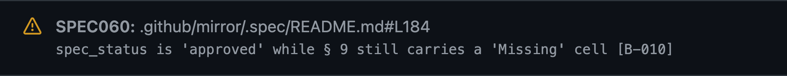

# Welcome to [Slidev](https://github.com/slidevjs/slidev)!

To start the slide show:

- `npm install`
- `npm run dev`
- visit <http://localhost:3030>

Edit the [slides.md](./slides.md) to see the changes.

Learn more about Slidev at the [documentation](https://sli.dev/).

## SDD Charcoal theme

This talk uses its own local theme in `theme/`: a dark charcoal canvas, soft
warm-gray text, muted teal structure, and copper emphasis. The dark background
supports the presenter's preference for lower screen brightness. Examples retain
the flat excerpt style and presentation typography. Colors, typography, and
spacing live in `theme/styles/theme.css`; Mermaid colors live in
`theme/setup/mermaid.ts` because Slidev renders diagrams inside shadow roots.
No theme publication or additional package installation is needed.

The theme targets the visual and interaction requirements in the
[Section 508 web guidance](https://www.section508.gov/develop/guide-accessible-web-design-development/).
Measured contrast against the charcoal background (`#202425`):

| Use                     | Color     | Contrast |
| ----------------------- | --------- | -------- |
| Main text               | `#d5d7d2` | 10.80:1  |
| Teal headings and links | `#83bdb7` | 7.41:1   |
| Copper emphasis         | `#dca58a` | 7.30:1   |
| Secondary text          | `#acb5b2` | 7.46:1   |

Code text has 9.22:1 contrast against its excerpt background (`#2b3031`);
teal inline code has 6.32:1 contrast against that background.
Commands, CLI output, and diffs share a terminal frame. The `$` prompt
stays out of copied commands. Diff additions and removals retain their
`+`/`-` markers and have text contrast of 8.53:1 and 9.14:1, respectively.
Links stay underlined, keyboard focus has a visible
outline, and transitions honor reduced-motion preferences. Fonts
use local system fallbacks. Illustrations have descriptive alt text. The
infographics use selectable text in reading order, and Mermaid diagrams have
accessible titles and descriptions.

The audience controls provide Previous/Next steps, a titled slide chooser with
an explicit Go action, fullscreen, and a presenter link. **Reading layout** makes
the slide fluid for browser zoom: text wraps, columns stack, and diagrams can be
scrolled with the keyboard.

The [accessibility review](accessibility-review.md) records browser scans,
structural and keyboard checks, a Safari 200% zoom review, contrast results, and
the repeatable check script. VoiceOver testing remains pending at the
presenter's request. PDF/PPTX exports need separate review if distributed.

## Delivery notes

The 42-slide deck has 47.5 minutes of prepared material in a 50-minute slot. Use the remaining 2.5 minutes for discussion. Each of the four section cards takes 15 seconds within its section.

| Slides | Section                      | Minutes |
| ------ | ---------------------------- | ------: |
| 1–10   | The spec returns             | 7.5     |
| 11–15  | The claim                    | 6       |
| 16–21  | My tokens!                   | 6.5     |
| 22–30  | My response                  | 13.5    |
| 31–41  | What to consider             | 11      |
| 42     | Questions                    | 3       |

| Slide | Cue the next section                                                                           |
| ----: | ---------------------------------------------------------------------------------------------- |
| 4     | “Before we get to replay, let's see what we kept from the binder.” |
| 11    | “Find the same designation in the feature file.” |
| 22    | “I kept paying for another review. What could I make the build catch?”                         |
| 31    | “Now imagine AC-011 shows up in your repo.”                                                   |

On slide 2, use the normal advance control to move the `AC-011` designation across the five sections. Each section has a matching cue in Presenter view. The next advance opens the disclaimer. Reading layout shows the designation above the full list.

Slide 7 turns from the cost of keeping the binder current to the reason Rodney brought the spec back. AI can help maintain it as code changes. On slide 8, click once for each panel: the binder, AI chat, then AI maintaining the spec. Click a fourth time for the closing line. Slide 9 picks up `AC-011` in the traceability matrix. Slide 15 turns from what AI maintains to what it maintained poorly. Slide 16 starts the private replay incident. On slide 21, reveal the request for review, then the return path and burning-cash punchline. Pause before showing the review counts. [Private evidence notes](./pr-evidence.md)

Slide 23 reveals the four SDD Inception boxes in order. Each incoming arrow appears with its destination. The three bullets appear with boxes 2–4. Specht stays unnamed until the final box and closing bullet appear together on click 4. Backward navigation reverses the reveals, and reading layout shows the complete diagram and bullets.

Keep replay as the running example throughout the deck, including the analyzer
links and evidence examples on slides 27–29. Use `.spec/README.md` for the
agreement and the adjacent `replay.feature` for scenarios. Keep original project
names and historical paths in the private evidence notes. Slides 1–22, including
their notes and accessibility text, do not name Specht.

## Follow AC-011

- **Establish the behavior.** Slides 9–15 introduce the reviewed replay spec and its metadata, the follow-up Gherkin scenario, and the rule for a store that refuses a write. The displayed IDs and paths are adapted. Slide 14 describes the desired TDD workflow. The historical scaffold was unimplemented.
- **Follow the drift.** Slides 18–21 contrast the design’s category 3 with category 1 in the revised claim and scaffold. The missing rows and wrong existing scenario tag are separate findings. The [presenter evidence notes](./pr-evidence.md) record the reviewed sources and distinguish them from the reported review cost.
- **Apply the checks.** Slides 23–28 show how the review led to Specht, which structural rules apply to the findings, and how the corrected replay scenario later became an executable check. The rules are applied retrospectively. The acceptance test injects a busy-store refusal, while a separate intake unit test checks the retry.
- **Review the evidence.** Slide 30 pairs the command diff with the acceptance scenario and its assertions. The test link opens slide 29 fully revealed. Slides 32–34 cover lessons, handoffs, and maintenance costs. Slide 35 asks when a stable ID pays for itself, then slide 36 illustrates a collision Rodney encountered with parallel agent sessions. Slide 37 shows why agents need the approved revision when the tracker and spec disagree. Slide 38 covers upkeep, and slide 39 asks what happens when the first replay write hits a busy store.

The replay walkthrough uses `.spec/README.md` and the adjacent `replay.feature`
as adapted display paths. The [private evidence notes](./pr-evidence.md) retain
the historical review paths. Slide 17 illustrates the structure with replay
names: `src/replay/.spec/` contains `README.md`, `replay.feature`, local
architecture decisions in `adr/`, and feature decisions in `decisions/`.
Global architecture decisions live in the root `.spec/adr/` directory, with
shared lessons in `.spec/lessons/`.

This is a slide-only walkthrough. Specht source links are pinned to `v0.4.2-preview`. Use the [Specht quick start](https://github.com/RLittlesII/specht#quick-start) for installation questions.

## Historical annotation

The earlier walkthrough showed a real GitHub Actions warning from Specht PR #277. Under the older schema, `SPEC060` flagged the approved mirror spec for marking claim `B-010`’s test `Missing`. The Specht step succeeded. An integration test failed later in the job. The replay walkthrough uses schema 0.3.0 to discuss the separate missing-row finding from the review. [Original PR annotation](https://github.com/RLittlesII/specht/pull/277/files#annotation_94350672913), [Actions run](https://github.com/RLittlesII/specht/actions/runs/40158738468)

