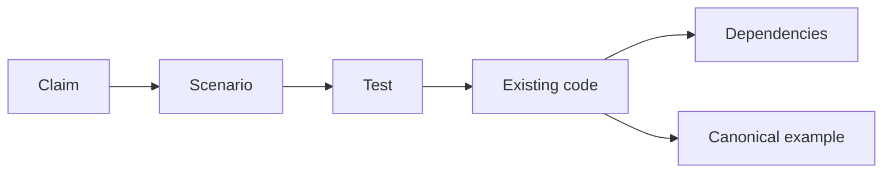

# Specification Driven Development

<div v-click class="sdd-subtitle">
  Who checks the spec?
</div>

<!--
Timing: 0.5 minutes. The specification returns: 8 minutes total, slides 1–8.

I like talking about my failures. They’re a surprisingly reliable source of conference material.

Click and ask “Who checks the spec?” I thought my review process had an answer. Then I tried it on a real change.
-->

---
layout: two-cols
layoutClass: gap-16
class: agenda
transition: slide-up
---

# Agenda

::right::

<v-clicks>

- **The spec returns** — same discipline, new reader
- **The spec at work** — from requirement to test
- **The review that went sideways** — when author and reviewer drift
- **Check the drift** — deterministic tools in the loop
- **Own the process** — monitor evidence, keep humans accountable

</v-clicks>

<!--
Timing: 0.5 minutes.

We will keep the history brief, follow one checkout requirement into a test, and use my review experience as the turning point. We finish with checks your team can put into its own workflow. Reserve the last three minutes for questions.

“Let’s start with how we wrote down what software should do.”
-->

---
transition: fade-out
class: illustrated
---

# In the Before Times

<div class="before-times-panels">
  <figure v-click="1" class="before-times-panel">
    <div class="before-times-art">
      
    </div>
    <figcaption><strong>Paper</strong>Think it through. Write it down.</figcaption>
  </figure>
  <figure v-click="2" class="before-times-panel" style="--panel-index: 1;">
    <div class="before-times-art">
      
    </div>
    <figcaption><strong>Punch cards</strong>Make every card count.</figcaption>
  </figure>
  <figure v-click="3" class="before-times-panel" style="--panel-index: 2;">
    <div class="before-times-art">
      
    </div>
    <figcaption><strong>The '90s spec</strong>The whole system. In a binder.</figcaption>
  </figure>
  <figure v-click="4" class="before-times-panel" style="--panel-index: 3;">
    <div class="before-times-art">
      
    </div>
    <figcaption><strong>The Agile era</strong>The binder becomes a backlog.</figcaption>
  </figure>
</div>

<div v-click="4" class="before-times-punchline">
  Somewhere along the way, we lost the whole picture.
</div>

<!--

Timing: 0.5 minutes.

Reveal paper, punch cards, the binder, and the Agile-era backlog in four clicks. The last click also reveals the punchline. Paper and punched cards often shared a workflow. Formal specs predate the '90s.

When running the program was expensive, we thought it through first. Eventually we had the binder. Behold the binder. Then, in some shops, the binder disappeared and the tickets survived. Agile did not ask us to shred the specification. We scattered the intent. Let's open the binder and see what was useful.

Source: https://agilemanifesto.org/

-->

---
transition: fade-out
class: archive
---

# A Spec, 1998

Purpose, requirements, constraints, design, verification, and approval. Open to one requirement:

```text
3.2.4  Discount Application

REQ-3.2.4.1  The system SHALL apply a valid discount code to the
             order subtotal prior to payment authorization.
REQ-3.2.4.2  The system SHALL reject a discount code whose expiry
             date precedes the current date and SHALL display
             message MSG-017 ("This code has expired").
REQ-3.2.4.3  The system SHALL NOT apply more than one discount
             code per order.
REQ-3.2.4.4  Orders with a subtotal of $75.00 or greater SHALL
             receive standard shipping at no charge.

Source:       BR-12 (Q3 Promotions)
Verified by:  TC-3.2.4.1, TC-3.2.4.2, TC-3.2.4.3, TC-3.2.4.4
Out of scope: Stacking, gift cards, loyalty points (see 3.2.7)
```

<!--

Timing: 1 minute.

This is an illustrative 1990s-style Functional Requirements Specification. Picture the whole binder: purpose and scope, requirements, constraints, design, verification, and approval. This page is one requirement inside it. The numbered claims, SHALL language, upstream source, and downstream test references are the useful parts. It is a fictional checkout example, not a historical document or a claim of compliance with a particular standard.

Read REQ-3.2.4.2 out loud. That is a test. Written by someone who never wrote a test.

-->

---
transition: fade-out
---

# What the Binder Got Right

- **Purpose** explains why the work matters.
- **Stable IDs** let us refer to the same requirement.
- **Boundaries** spell out what to preserve and what to leave out.
- **Traceability** links requirements to the tests that check them.

<v-click>

<div m="t-6">

Keeping it current was the hard part.

</div>

</v-click>

<!--

Timing: 1 minute.

Go back to the expired-code requirement. We can point to its ID, see what checkout must do before payment, and find the test that is supposed to check it. The binder made those connections visible while they were current.

Click for the maintenance cost. When the behavior changed, somebody had to bring the requirement, the test, and the approval back into agreement. It was easy for a copy of the binder to fall behind. Then the binder got a new reader.

-->

---
transition: fade-out
class: illustrated
clicks: 1
---

# The Spec Is Back

<div class="sdd-spec-panels">
  <figure>
    
    <figcaption>
      <strong>Old busted</strong>
      <b>The specification</b>
      Write it. File it. Forget it.
    </figcaption>
  </figure>
  <figure v-show="$clicks >= 1">
    
    <figcaption>
      <strong>New hotness</strong>
      <b>AI chat</b>
      Prompt it. Patch it. Repeat.
    </figcaption>
  </figure>
  <figure v-show="$clicks >= 1">
    
    <figcaption>
      <strong>Old busted hotness</strong>
      <b>The spec guides the agent</b>
      Specify it. Test it. Regenerate.
    </figcaption>
  </figure>
</div>

<div v-show="$clicks >= 1" style="margin-top: 1rem; text-align: center; font-style: italic;">
  The spec is the prompt.
</div>

<!--

Timing: 1.5 minutes.

Start with the dusty binder. “The old busted spec has a new job. I call it old busted hotness.” Pause after the line, then click once to reveal the other two panels together. This is the first time the talk names AI.

The middle panel is what happened when I asked AI for code and kept the decisions in chat. I had to keep repeating what mattered. The right panel is what changed when I gave the agent the versioned agreement. It could work from the goal, the boundaries, and the same requirements we use to check its work. People still decide what the software should do, and tests give us evidence about what it does.

“The spec is the prompt. Here’s the checkout spec I give that agent.” Advance directly to “My Specification, 2026.”

-->

---
transition: slide-up
---

# My Specification, 2026

Versioned Markdown: **YAML frontmatter**, then a structured agreement.

<div grid="~ cols-2 gap-8" m="t-4">
<div>

**Intent and boundaries**

```text
1. Business Goal
2. User Needs
3. Acceptance Criteria
4. Constraints
5. Out of Scope
6. Concern Separation
```

</div>
<div>

**Design and evidence**

```text
7. Technical Design
8. Testing Strategy
9. Traceability Matrix
10. Lessons / Spec Deltas
11. Open Questions
12. Sign-off
```

</div>
</div>

The agent gets the reason, the limits, and how we will verify the work.

<!--
Timing: 1.5 minutes.

This is the modern representation I came up with. It is my feature-specification contract, not a claim that every AI workflow needs these exact headings. The file starts with YAML metadata, then these twelve numbered sections. Tasks and Scoring are additional unnumbered sections in the full template. The labels shown here match the versioned 0.2.1 template used by this talk's checker examples.

Read the outline as questions the next reader needs answered. Why are we doing this, and for whom? What must happen, what limits apply, and what are we deliberately excluding? Concern Separation distinguishes business and technical responsibilities. Technical Design records the intended boundaries and contracts; Testing Strategy explains how we will exercise them. Traceability connects each acceptance criterion to its scenarios and tests. Lessons change the owning sections; open questions and sign-off make unresolved decisions and review visible.

Keep checkout concrete: clear pricing is the goal; an expired code must be rejected; payment must not start first; stacking is excluded. Section 3 gives that agreement an ID. Sections 8 and 9 explain the checks and their links. These are the sections the audience will see drift later, not disconnected documentation headings.

The difference from the binder is how we use and maintain the agreement: keep it versioned, give the relevant revision to the agent, review its changes, and repeat the checks. Markdown alone does none of that. First look at the metadata at the very top of this same file.

Source: Specht src/tool/templates/v0.2.1/feature.md, checked in the local source checkout. Section names are literal; checkout content is illustrative.
-->

---
transition: slide-up
---

# Frontmatter Is Part of the Contract

Frontmatter is the YAML block at the top of the specification.

<div grid="~ cols-2 gap-8" m="t-4">
<div>

```yaml
---
id: F2
epic: "0001"
type: feature
spec_status: approved
status: in-progress
depends_on: []
blocks: []
---
```

Excerpt for the checkout feature.

</div>
<div style="align-self: center;">
  <p style="border-left: 3px solid var(--sdd-copper); padding-left: 1rem;">
    <code>spec_status</code><br />
    <strong>Agreement approved</strong>
  </p>
  <p style="border-left: 3px solid var(--sdd-copper); padding-left: 1rem;">
    <code>status</code><br />
    <strong>Delivery in progress</strong>
  </p>
</div>
</div>

<!--
Timing: 1.5 minutes.

Frontmatter is the YAML between the opening and closing triple-dash lines, before the Markdown body. These are specification metadata, separate from Slidev's presentation frontmatter. This is an abbreviated teaching example, not a complete schema-valid file. The full template also carries author, dates, domain, planning, and synchronization fields. The displayed keys and values match the pinned 0.2.1 feature-frontmatter schema.

F2 is scoped to epic 0001, so a cross-feature reference includes both. Type selects the feature document contract. Spec_status records document maturity; status records delivery state. An approved agreement can be in progress: approval is not a claim that implementation or testing is complete. Dependencies are explicit relationships, not guesses an agent should reconstruct from prose. Here both lists are empty; do not read that as a dependency failure in the real incident.

These fields affect how the workflow interprets the document. A syntactically valid YAML block can still violate the schema or disagree with the body and related files. Check the required fields, permitted values, and declared relationships using the selected contract. Human review still establishes whether an approval is justified and whether the dependency declarations are correct.

Frontmatter was also part of the review problem that burned my tokens. That connection comes from my account; the retained evidence notes do not identify a specific broken key or diff, so do not invent one. The important setup here is that the contract includes metadata as well as prose. Later, Specht will analyze that contract repeatedly as the specification changes.

“You’ve seen the agreement. Let’s follow one claim from the spec into a test.”

Sources: Specht src/tool/templates/v0.2.1/feature.md and src/tool/schema/v0.2.1/frontmatter/feature.schema.json, checked in the local source checkout. Frontmatter's role in the token incident: Rodney's account, November 5, 2026.
-->

---
transition: fade-out
---

# TDD, BDD, SDD

<v-clicks>

- **Test Driven Development** — failing test, implementation, refactor
- **Behavior Driven Development** — agreed behavior, scenarios, executable checks
- **Specification Driven Development** — explicit intent guides the agent's work

</v-clicks>

<v-click>

**SDD still needs BDD to agree on behavior and TDD to verify it.**

</v-click>

<!--
Timing: 1 minute. How agents use the spec: 6 minutes total, slides 9–12.

Keep this connection from the original talk. SDD belongs alongside disciplines the audience already knows. BDD turns claims into examples people agree on. TDD drives implementation through red, green, refactor. SDD supplies the versioned intent that connects them. Use all three together; a generated spec does not replace either discipline. We still need good tests and shared understanding. Writing intent upstream gives the agent a durable input, but does not make everything downstream automatic or correct.

The important change is where the next task starts: from agreed behavior and constraints rather than a fresh explanation in every chat. Tests, design choices, and code still require judgment. Next, follow one requirement through those handoffs.
-->

---
transition: slide-up
---

# Meet the Actors and Artifacts

<div grid="~ cols-2 gap-8" m="t-2">
<div>

**Who acts**

- **Human:** owns intent and acceptance
- **AI agent:** a model with instructions and tools; proposes and makes edits
- **Programs:** test runners execute checks; validators enforce explicit rules

</div>
<div>

**What they work on**

- **Feature:** a scoped capability, such as applying discount codes
- **Specification:** the versioned agreement on behavior, constraints, and scope
- **Claim:** one numbered, testable requirement in that agreement

</div>
</div>

People decide. Agents do work. Artifacts record the agreement and evidence.

<!--
Timing: 1.5 minutes.

Give the audience this vocabulary before showing agent handoffs. These are different kinds of participants: people and agents take actions; specifications and features are the subject of the work; deterministic programs supply particular checks. Do not imply that a document has agency or that a model owns the product decision.

Human means the people responsible for product intent, design, testing, and acceptance. One person may hold several responsibilities. AI means the model; an agent puts that model in a workflow with instructions, context, and tools so it can act. An agent can draft a spec, edit code, or review a diff, but the human remains accountable for approving meaning and accepting the result.

Feature here means a bounded product capability, such as applying discount codes. Its spec is the versioned agreement covering that capability: why it exists, testable claims, constraints, and exclusions. A claim is one acceptance criterion with a stable ID, such as AC-002. The implementation is the code that delivers the behavior; the spec describes what that behavior should be.

A test runner executes test code and reports what its assertions observed. A structural checker such as the tool introduced later compares artifacts with explicit rules. Neither is a product owner. A passing structural check and a passing behavioral test answer different questions.

Next assign the agent jobs, then use the checkout example to explain Gherkin, scenarios, and how their words become executable checks. Later, the file-layout slide shows where these artifacts live in this repository convention.
-->

---
level: 2
---

# Roles as Agents

| Role        | Reads                                  | Produces                    |
| ----------- | -------------------------------------- | --------------------------- |
| Spec author | Human intent, current spec             | Proposed spec delta         |
| Test writer | Approved claims, constraints           | Scenarios and failing tests |
| Implementer | Spec, tests, existing code             | Scoped implementation       |
| Reviewer    | Approved baseline, all diffs, evidence | Findings tied to claims     |

<v-click>

Instructions define the handoff. Tools check its explicit rules.

</v-click>

<!--
Timing: 1.5 minutes.

The actors now have jobs. Spec author, test writer, implementer, and reviewer are responsibilities assigned to an agent through its instructions and tools. The table describes a workflow contract, not a requirement for four separate sessions. You can use fewer agents and still preserve the responsibilities.

Notice that the spec author may be an agent too. I still own the intent. The author proposes changes; it does not get authority to redefine the requirement silently. The reviewer needs the approved baseline as well as the new spec. Otherwise, what prevents both roles from agreeing on a new requirement I never asked for?

For now, this looks reasonable. We have roles, files, tests, and a review. We have all the ingredients for a responsible workflow. That is what made the failure so frustrating.
-->

---
layout: two-cols
layoutClass: gap-8
class: claim-example
---

# One Claim Through the Loop

**Feature:** discount-code validation.

**Claim `AC-002`**

Reject an expired discount code and show an expired-code message.

**Constraint:** rejection happens before payment.

**Out of scope:** stacking discount codes.

::right::

**Gherkin:** a language for behavior examples.

```gherkin
Feature: Discount codes

  @AC-002
  Scenario: Reject an expired code
    Given a cart worth $50
    And SAVE10 expired yesterday
    When SAVE10 is applied
    Then the total remains $50
    And an expired-code message appears
```

A **scenario** is one example. **Bindings + a runner** execute its steps and assertions.

<!--
Timing: 2 minutes.

Explain the example using the vocabulary just introduced. The feature is the capability; the spec is its agreement; AC-002 is one claim in it. Gherkin is the structured language used in the .feature file. Feature: groups related scenarios; Scenario: names one concrete example; Given sets the starting state, When describes the action, and Then describes the expected result. And adds another step of the same kind.

A .feature file contains Gherkin, not application code. Step definitions (also called bindings) connect the step text to executable code. Then bindings perform assertions against observed behavior when the test runner executes them. For example, asserting both a $50 total and the expired-code message checks the two outcomes of AC-002. Writing the scenario or adding a claim tag alone does not run a test.

This is the condensed spec anatomy and Gherkin example. The business goal is clear checkout pricing. The user needs feedback when a code cannot be used. The claim is falsifiable, the constraint sets a boundary, and out of scope limits what the agent should add. We are keeping the checkout example from the existing talk.

For the modern examples, AC-002 is our short claim identifier for the expired-code requirement previously shown as REQ-3.2.4.2. This is an explicit presentation mapping, not an instruction to renumber real requirements. The @AC-002 tag carries that identity into the scenario; it is a reference, not an assertion. Traceability records the links from the claim to its scenarios and tests. The test needs assertions for both the unchanged total and the message. A descriptive test name alone proves neither.

Ask the audience to consider what happens if the tag disappears, then what happens if the author changes 'reject' to 'accept.' Those are different failures. One concerns the relationship and the other concerns the intent.

“I thought having those roles and checks would be enough. Here’s what happened when I tried it.”

Terminology source: https://cucumber.io/docs/gherkin/reference/ (Feature, Scenario, Given/When/Then, step definitions, and assertions).
-->

---
layout: center
class: text-center
transition: fade
---

# My Precious Tokens

<div style="margin-top: 2rem; font-size: 1.8rem; line-height: 1.5; color: var(--sdd-copper);">
  “I burned a week's worth of Claude Max tokens<br/>trying to review a pull request.”
</div>

<div style="margin-top: 1.5rem; color: var(--sdd-muted);">Frontmatter, sections, and references all needed checking</div>

<!--
Timing: 1 minute. The token horror story: 9 minutes total, slides 13–18.

This is my account of what happened. The quote describes my experience with the review cycle, not a benchmark of Claude or a measured comparison between tools. The review counts later in the story come from my account, including work away from GitHub. Do not infer them from GitHub event counts or invent a dollar amount.

As always, this is a story from the trenches.  This is a real story, all tokens discussed in it were burned frivolously and it was not completely the fault of the provider.

I had the frontmatter and the structured sections we just opened. Frontmatter was part of the problem too; the examples that follow show the retained body and reference findings. I had an author. I had a reviewer. And I was burning those tokens on the process that was supposed to keep the work honest. This is the horror story promised in the opening.
-->

---
transition: slide-up
class: artifacts
---

# The Files Behind the Workflow

**My repository layout**

<div role="group" aria-label="Checkout contains feature code and a dot-spec folder with the README, scenarios, architecture decisions, product decisions, and lessons. Dot-specht sits at the repository root.">

```text
repo/
├── checkout/
│   ├── …                     Feature code
│   └── .spec/
│       ├── README.md         Agreement and claim links
│       ├── checkout.feature  Scenarios
│       ├── adr/              Design decisions
│       ├── decisions/        Product decisions
│       └── lessons/          What to change next time
└── .specht/                  Checker config, schemas, templates
```

</div>

<!--
Timing: 1 minute.

The modern specification we opened earlier was one file in a larger set. Follow the tree from the repository root to checkout. The feature keeps its .spec folder beside its code. Dot-spec holds the agreement and supporting records. Dot-specht lives at the repository root and holds checker configuration, schemas, and starter templates.

This tree uses checkout to illustrate my repository convention. The review incident involved the same kinds of artifacts. Your approved intent might live in GitHub Issues, Azure DevOps, or Trello. Name the authoritative source and revision so the next person or agent can retrieve the same agreement. We will return to those variations later.

The README records claims, scope, and traceability. The feature file supplies the tagged scenarios we just saw. ADR means Architecture Decision Record: the technical choice and why. Product decisions preserve what we chose to build or exclude. Lessons record what failed and the change that should follow. An agent needs to retrieve and apply the relevant record.

These paths are feature-local; records spanning features belong at the repository root. Keep this an orientation, not a tour of every heading. Checker templates are blanks to fill, not finished requirements. Installing Specht does not write intent, execute scenarios, or configure the handoffs. Its base rules check selected structures and relationships, not the truth of arbitrary decision or lesson prose.

Sources: https://github.com/RLittlesII/specht/blob/main/docs/setup.md ; https://github.com/RLittlesII/specht/blob/main/docs/what-it-checks.md ; https://github.com/RLittlesII/specht/tree/main/.specht/templates
-->

---
transition: slide-up
---

# The Claim in This Incident

A **numbered, testable acceptance criterion**: what the system must do.

**Example phrasing — the intended replay behavior**

```text
AC-011: If the store is busy or unreadable, report an
       environment failure and exit with category 3.
```

- **ID:** `AC-011` gives that agreement a stable reference
- **Scenario:** a concrete example that exercises the claim
- **Traceability:** the links from the claim to its scenarios and tests

Keep the intended category in view. Next, watch it change.

<!--
Timing: 1 minute.

AC stands for acceptance criterion. For consistent presentation, the audience-facing deck uses AC- identifiers; the source repository uses B-. Thus B-011 is displayed as AC-011, and B-003 as AC-003. This is a presentation mapping, not a recommendation to renumber existing repository IDs. Original identifiers remain in pr-evidence.md and the source-specific notes.

A claim is an individual requirement we can challenge with evidence, not a vague aspiration such as 'replay should work well.' Its identifier lets authors, scenarios, tests, and reviewers refer to the same agreement. IDs are stable within their feature; a full reference includes the feature when we cross its boundary. B-011 in one feature need not mean B-011 in another.

The displayed wording is a simplified explanation of the intended behavior, not a verbatim historical excerpt. The actual replay case distinguishes an environment failure, category 3, from a rejected request, category 1. We need only that distinction to understand the next slide. We are not teaching the entire replay design.

A scenario gives a concrete input and expected result. A traceability row records which scenarios and tests relate to the claim. An existing row is not proof that its test runs, passes, or asserts the right thing. Likewise, a valid ID cannot make incorrect wording true.

Bridge from the checkout example to the incident: the mechanism is the same, but the real repository was handling replay failures. Set up the drift: what happens if the claim says category 1 while the design says category 3, and a downstream test author copies the claim? That is the actual incident on the next slide. Keep the reference stable, review changes to meaning, and check the relationships mechanically where possible.

Source provenance for the actual exit-category contradiction: pr-evidence.md, 'A wrong claim propagated into a scaffold.' This slide's short requirement sentence is explanatory phrasing.
-->

---
transition: fade-out
---

# The Spec Started Drifting

**Actual review evidence: a replay command**

| Same failure: store busy or unreadable | Exit category |
| -------------------------------------- | ------------- |
| Revised claim `AC-011`                 | **1**         |
| Design § 7, `R3` / `R13`               | **3**         |
| Test stub's expected result            | **1**         |

```cs
// Then a structured failure is reported and the exit code is category 1
```

The incorrect claim propagated into the test scaffold.


<!--
Timing: 2 minutes.

This is actual PR evidence from a private project. The project was changing its replay write path to an append-only request consumed later by the daemon. The domain detail we need: a busy or unreadable store is an environment failure, which the design maps to exit category 3.

At reviewed commit fdbae932c81169920f2e3d2eba0f8b2f676e838f, feature 0005-F5b's revised B-011 included store/config preconditions and busy-timeout in category 1. The same spec's § 7 R3/R13, domain row, and diagrams mapped StoreBusy/StoreUnreadable to category 3. The staged test copied the category-1 expectation. The line on screen is verbatim from ReplayCommandHandler.Unit.Tests.cs:153 at that commit. This was a scaffold: its body called Assert.Fail("not implemented — scaffold only"). Do not describe it as a passing executable test or a shipped production bug.

The review explicitly identified that the stub inherited the wrong reading. It caught this contradiction; the evidence does not show that every reviewer blindly accepted the spec. My account supplies the broader author/reviewer cycle and token cost. GitHub supplies concrete contradictory artifacts and remediation history.

Source provenance: see pr-evidence.md for the reviewed artifacts, original PR identifiers, and pinned source links.
-->

---
transition: slide-up
---

# The References Drifted Too

**Actual review evidence: the original and follow-up PRs**

- **Original PR:** five accepted claims, zero traceability rows
- **Follow-up PR:** scenario tagged `@AC-011`; the spec says `AC-003` governs it
- **Follow-up PR:** the scenario appeared under neither claim in § 9

**The verified correction — IDs shown as `AC-`**

```diff
-    @AC-011
+    @AC-003
```

The correction also added the scenario to `AC-003`'s traceability row.

<v-click>

**A wrong reading can spread into the claim, the test, and a false sense of confidence.**

</v-click>


<!--
Timing: 2 minutes.

These are separate findings across the two PRs, not one invented diff. In #214, the review of 0001-F4 found five accepted claims B-001–B-005 with no § 9 rows. The document argued that rows would wait for scenarios, but the contract required one row per claim even when its test was marked Missing. An explicit gap and an absent row are different states.

In #215, the replayed-secret-failure scenario had already been rewritten to describe a later listing of an attempt's failure. Its tag still said B-011. The spec's own B-011 text now assigned that behavior to B-003, yet neither claim's § 9 entry listed the scenario. Both IDs existed. Merely checking whether a tag resolves would not catch assignment to the wrong claim; the human semantic finding determines the intended assignment.

At reviewed commit 4e95b5b7bdddeab266f8d0f7631b0a13307ca76d, the feature tag was @B-011 at line 110, and the two matrix rows omitted the scenario. Correction commit 90ab1fed669bcae50b5bafad159bc59583a2f1cd retagged it @B-003, added the scenario title to B-003's row, and reconciled related citations. The diff on screen preserves the actual tag correction, with B- prefixes displayed as AC- and the unchanged scenario title omitted for readability.

This shows the distinction needed for Specht: missing required rows can be checked mechanically. Determining which valid claim describes a scenario's meaning still needs review. Do not claim Specht automatically diagnoses the semantic misassignment just because it can validate references.

Land the two failures: the wrong meaning spread, and the relationships drifted. Agreement between files may only mean they copied the same mistake. Checking whether a row exists is a different job from deciding whether its claim is right.

One more thing went wrong: even the lessons from this review contained mistakes. Hold that thought. First, the token bill and the check I could build. We will come back to what a lesson has to change before the next run.

Source provenance: see pr-evidence.md for the reviewed artifacts, original PR identifiers, and pinned source links.
-->

---
layout: center
class: text-center
transition: fade
---

# Author. Reviewer. Repeat.

**My account of the review effort by the time it was done**

| Review effort            | Scale                              |
| ------------------------ | ---------------------------------- |
| Comments on the PR       | More than 200                      |
| Reviews away from GitHub | About half                         |
| AI reviews               | 20+                                |
| Rounds per AI review     | 10+; highest I recall: 18          |

<div style="margin-top: 1rem; font-size: 1.3rem; color: var(--sdd-copper);">Burning tokens like cash to keep warm.</div>

<v-click>

**Wait. I can build a thing to check these rules.**

</v-click>

<!--
Timing: 2 minutes.

I was paying for repeated review of the specification contract: frontmatter, section structure, and relationships, as well as meaning. The frontmatter connection is my account, without a specific key-level example in the retained evidence. The repair history is visible; the token bill and review-effort figures are my reported experience. By the time the PR was done, there were over 200 review comments on it. About half the reviews happened away from GitHub. There were 20+ AI reviews, each taking 10+ rounds; the highest I recall was 18 rounds. A review and a round within that review are different units. These figures were supplied for this talk on October 28, 2026; they are not counts reconstructed from GitHub events. PR #214 contains repeated review-remediation commits, including d25739a (review feedback), 0aa4962 (traceability rows), and d953cac (lesson-register integrity collapse). It was closed without merging. My closing comment called it “a reminder of what to do when AI goes rogue!” The full comment is preserved in pr-evidence.md.

PR #215 continued with spec, feature-file, and scaffold changes, received further change requests, and ultimately merged on October 7, 2026. This was not an endless unresolved PR: show the eventual outcome as well as the failure. Do not equate the number of GitHub review events, replies, or commit messages with a verified count of internal model-review rounds. The retained history includes rewritten/squashed material.

Land the cost metaphor: I was burning tokens like cash to keep warm. The review loop kept running, but we kept paying to rediscover rules we already knew. Pause before advancing the reveal.

Reveal the eureka moment: “Wait. I can build a thing to check these rules.” Let the audience sit with that change in direction: from paying for another review to engineering a check for a recurring failure. I could build something to address the mechanical part of the problem that was burning my tokens. This does not mean a checker could settle every semantic disagreement or guarantee savings.

The follow-up eventually merged, but getting to a merge had exposed a process problem. I needed to fix the repository workflow that had produced this loop. Advance from the reveal to “SDD Inception” to show how the check became a tool.

Source provenance: see pr-evidence.md for the reviewed artifacts, original PR identifiers, and pinned source links.
-->

---
transition: slide-up
clicks: 4
---

# SDD Inception

```mermaid {key: $clicks, scale: 0.75, themeCSS: ['.sdd-step-1', '.sdd-step-2, .flowchart-link[data-id=edgeAB]', '.sdd-step-3, .flowchart-link[data-id=edgeBC]', '.sdd-step-4, .flowchart-link[data-id=edgeCD]'].map((selector, index) => selector + ' { visibility: ' + ($clicks > index ? 'visible' : 'hidden') + '; }').join(' ')}
graph LR
accTitle: How Specht grew out of SDD
accDescr: Using SDD to build software exposed drift in the process. SDD then guided the development of Specht, which checks SDD artifacts.
A["Use SDD<br/>to build software"] edgeAB@--> B["Discover drift<br/>in the SDD process"]
B edgeBC@--> C["Use SDD<br/>to build Specht"]
C edgeCD@--> D["Use Specht<br/>to check SDD artifacts"]
class A sdd-step-1
class B sdd-step-2
class C sdd-step-3
class D sdd-step-4
```

<v-clicks :at="2">

- Fix the repository where the drift happened
- My request: **“Think of the spec like a JSON Schema.”**
- **And Specht was born.**

</v-clicks>

<!--
Timing: 1.5 minutes. Building a way out: 8.5 minutes total, slides 19–24.

Reveal the diagram from left to right on four clicks. Click 1: using SDD to build software. Click 2: discovering drift, together with the repository-fix bullet. Click 3: building the checker, together with the JSON Schema request. Click 4: applying it to SDD artifacts, together with “And Specht was born.” Each incoming arrow appears with its destination. The diagram keeps its full layout throughout.

This is SDD Inception: I used specification-driven development, discovered drift in the process, and asked for a fix in the affected repository. My instruction was to think of the spec like a JSON Schema. That request gave rise to Specht: an analysis tool I built to keep tabs on the specification process. SDD then guided development of the tool for specification-driven development. The origin was a concrete repository problem.

The analogy is a checkable contract: required structure, identities, and relationships with reproducible diagnostics. It does not mean every Markdown claim is literally JSON Schema, or that schema validation proves the business meaning of a requirement. Let that nesting be the joke. The point is the method being applied to improve the method itself.

The need was concrete: preserve the structural contract so agents could proceed with useful evidence. Specify the checks, test valid and broken inputs, build the checker, and apply it to the artifacts in the workflow. The diagram expresses that relationship, not a claim that the PRs contain every step of Specht's implementation history.

Build tools like Specht to improve your own AI specification-driven process. A focused script that checks one recurring failure is a useful start. Specify the invariant, write failing examples and valid controls, implement it, then put the result in the handoff. This is BDD and TDD applied to the SDD tooling itself.

The checker is software too. Next, meet the tool, follow one check through a repair, then turn that same failure into examples we could use to build and test the checker. That is the nesting: use SDD to specify the tool that checks our SDD artifacts.

-->

---
transition: slide-up
---

# Meet Specht


<div style="max-width: 530px;">

A .NET analysis tool I built to keep tabs on the specification process.

<v-clicks>

- YAML frontmatter against its schema
- Required sections and their order
- Claim IDs, references, and traceability
- Declared dependency consistency

</v-clicks>

<div style="margin-top: 1.5rem; color: var(--sdd-copper);">Run after edits. Carry findings into the next handoff.</div>

[github.com/RLittlesII/specht](https://github.com/RLittlesII/specht)

</div>

<!--
Timing: 1 minute.

That request became Specht. I built it as an analysis tool to keep tabs on the specification process. It analyzes the metadata, sections, and relationships we opened earlier so repeated contract checks become software instead of another model-review round. Its job is to make the specification contract mechanically checkable. It checks explicit rules against the spec tree and reports violations. The checker runs offline; pinning the tool and schema versions keeps the rule set reproducible across machines and CI.

Keep the description narrow. It does not understand whether accepting expired codes serves the business. It can check whether claims have the expected IDs and traceability relationships, whether feature tags resolve, and whether declared dependencies agree.

The callback: my precious tokens should go toward reasoning that needs a model, while a deterministic checker handles the rules it can enforce. This is a design choice about the workflow, not a measured claim about savings. Return to the checkout claim from the opening: we can demonstrate the same missing-row failure without teaching the entire private replay system.

Source: https://github.com/RLittlesII/specht (README: checker, pinned schema, supported checks).
Logo: existing dark-background SVG from Specht's .assets/logos/specht-book-logo-dark.svg, reused unchanged.
-->

---
transition: fade-out
---

# A Claim Loses Its Traceability Row

<div class="sdd-traceability-example">

<p v-click="1" class="sdd-traceability-cue">1. The claim is still here.</p>

```markdown {none|5} {at: 1}
## 3. Acceptance Criteria

| ID     | Claim                 | Source | Status |
| ------ | --------------------- | ------ | ------ |
| AC-002 | Reject expired codes. | need 1 | Active |
```

<p v-click="2" class="sdd-traceability-cue">2. Its traceability row was deleted.</p>

```diff {none|5} {at: 2}
 ## 9. Traceability Matrix

 | Claim ID | Scenario     | Test              | Status  |
 | -------- | ------------ | ----------------- | ------- |
- | AC-002   | Expired code | RejectExpiredCode | Covered |
```

<p v-click="2"><strong>Every claim in § 3 needs exactly one row in § 9.</strong></p>

</div>

<!--
Timing: 1.5 minutes.

Start with both excerpts visible. On click one, point to AC-002 in § 3: we still require checkout to reject expired codes. On click two, point to the same ID and the deletion marker in § 9. The claim remains and its verification link is gone. Read the one-row rule, then advance to the diagnostic for AC-002.

This is an illustrative checkout reconstruction, using the actual default template's section headings and table columns. Cells are shortened to fit. AC-002 still means rejecting the code and displaying the expired-code message, before payment. The full claim and scenario were introduced earlier.

Use an AC-prefixed identifier grammar in the manifest for these teaching examples; Specht's default grammar uses B-. These are excerpts, not a complete runnable specification. Assume the remaining document and companion are valid.

This mirrors the original incident's five accepted claims with no traceability rows. SPEC031 compares the claim IDs in the first cells of the claims and matrix tables, requiring exactly one matrix row per claim. A Missing test is an explicit gap; deleting the whole row loses that information. No model needs to reason about whether the row is present.

Sources: Specht .specht/templates/feature.md and docs/rules/v0.2.1/SPEC031.md in the local source checkout; public rule reference: https://github.com/RLittlesII/specht/blob/main/docs/rules/v0.2.1/SPEC031.md
-->

---
transition: fade-out
clicks: 2
---

# A Diagnostic the Agent Can Act On

**Expected checkout finding from `dotnet specht`**

```text
error SPEC031 [AC-002]
claim 'AC-002' has no row in § 9 - every § 3 claim
appears there exactly once, with 'Missing' as its
test until one exists
```

<v-click>

File + line + rule + claim → a bounded repair before the next handoff.

</v-click>

<figure v-show="$clicks >= 2" style="margin: 1rem 0 0;">
  
  <figcaption style="font-size: 1.125rem; margin-top: 0.5rem;">
    Specht warning SPEC060 at line 184. The approved spec still marks the test for B-010 as Missing.
    <a href="https://github.com/RLittlesII/specht/pull/277/files#annotation_94350672913">View the GitHub annotation</a>.
  </figcaption>
</figure>

<!--
Timing: 1.5 minutes.

The message follows the canonical SPEC031 rule reference for schema 0.2.1, with AC-002 substituted consistently for our checkout example. Line wrapping and the separate rule/identifier heading are presentation formatting. This is expected diagnostic content, not captured CLI output. Actual reports include the file and line at the claim's row in section 3; no invented line number is shown.

Point out the stable claim reference: the failure and repair concern the same AC-002 we followed from the scenario. Keep the claim identity consistent from the scenario through the failure and repair.

The orchestrator or CI must honor failure. Printing a diagnostic alone does not stop another agent continuing. Give the author the finding and the approved baseline, then require a new check result for the repaired revision.

On the last click, show the real GitHub Actions warning from Specht PR #277. Checkout lost its traceability row. In this PR, the row was present, and Specht flagged the Missing test for claim B-010 while the spec was marked approved. GitHub puts the rule and exact line in the reviewer's hands. The Specht step succeeded. The integration test failed later in the job. Return to checkout for the repair on the next slide.

GitHub Actions capture: https://github.com/RLittlesII/specht/actions/runs/40158738468
Original annotation: https://github.com/RLittlesII/specht/pull/277/files#annotation_94350672913
Pinned spec line: https://github.com/RLittlesII/specht/blob/b3aa28b0d05e3fcabcc72e7312c35a8fc04d1fad/.github/mirror/.spec/README.md#L184

Source: https://github.com/RLittlesII/specht/blob/main/docs/rules/v0.2.1/SPEC031.md (checked against the local rule reference).
-->

---
transition: fade-out
---

# Restore the Relationship

**Preserve the claim. Record the evidence you actually have.**

```diff
 ## 9. Traceability Matrix

 | Claim ID | Scenario     | Test              | Status  |
 | -------- | ------------ | ----------------- | ------- |
+ | AC-002   | Expired code | RejectExpiredCode | Covered |
```

<v-clicks>

- BDD: agree on the unchanged total and expired-code message
- TDD: see the assertions fail, implement, pass, then refactor
- Validate the links again; review the spec and test diffs

</v-clicks>

<!--
Timing: 1.5 minutes.

The row uses the canonical matrix columns with shortened scenario/test labels. Restore Covered only after inspecting and executing the actual test, including both assertions and the before-payment constraint. A row is a declaration, not proof that the test exists or runs.

Use AC-002 to review coverage. The first scenario uses a code that expired yesterday. Ask the domain owner when a code becomes expired and which clock or time zone governs that boundary. The test checks both the unchanged total and the expired-code message. Add a check that payment authorization was never attempted. If exploring the running checkout exposes another gap, agree on the expected behavior and add a regression test.

If the test does not exist yet, use Missing for Test and Status. SPEC031 accepts that explicit gap. SPEC060 separately reports Missing cells when spec_status is approved, with error severity by default; repository policy can change that severity. Do not fabricate a test name or remove the claim to make a check pass.

BDD still supplies shared examples. TDD still checks that the implementation makes the relevant failing tests pass and supports refactoring. Structural checks complement both. Humans review whether the examples and assertions preserve the approved behavior.

Source: https://github.com/RLittlesII/specht/blob/main/docs/rules/v0.2.1/SPEC031.md ; https://github.com/RLittlesII/specht/blob/main/docs/rules/v0.2.1/SPEC060.md
-->

---
transition: fade-out
---

# SDD for the Checker

**Requirement:** every claim has exactly one traceability row.

| Example input for `AC-002` | Expected `SPEC031` result |
| -------------------------- | ------------------------- |
| No matrix row              | Fail: missing row         |
| Exactly one matrix row     | Pass this rule            |
| Two matrix rows            | Fail: duplicate rows      |

<v-click>

Write the failing examples. Build the check. Keep the valid case green.

</v-click>

<!--
Timing: 1.5 minutes.

Now turn the workflow around. We just used the checker; how would we specify and test this part of it? Here is a small worked example of applying SDD to the checker, not a reconstruction of Specht's implementation history.

The requirement is exactly one matrix row per claim. Agree on examples: zero rows fails, one passes this rule, two fails. Use otherwise valid fixtures so we know which rule we are exercising. A duplicate matrix row is different from declaring the claim itself twice.

Write executable tests for the missing and duplicate cases and a valid control. See the relevant assertions fail before implementing the check, make them pass, then refactor. The valid control catches an implementation that simply rejects everything. That is BDD and TDD doing useful work inside SDD Inception. Give your precious tokens a problem worth reasoning about; let a test runner repeat these examples.

The one-row case passes SPEC031 only. It does not establish full validation or behavioral correctness. For example, the row can list a scenario that exercises a different claim.

“The checker can tell us a row is missing. Who decides whether the requirement itself is right?”

Source for the invariant: https://github.com/RLittlesII/specht/blob/main/docs/rules/v0.2.1/SPEC031.md (checked against the local schema 0.2.1 rule reference). These are expected rule results, not captured CLI output or claims that these exact tests were used to build Specht.
-->

---
transition: slide-up
---

# Who checks the spec?

- **Specht** checks the spec’s structure and links.
- **Tests** check how the software behaves in the scenarios we exercise.
- **People** decide what the software should do and whether the evidence supports accepting the change.

<v-click>

A well-formed instruction to accept expired codes is still the wrong instruction.

</v-click>

<!--
Timing: 1.5 minutes. Owning and adapting the workflow: 12.5 minutes total, slides 25–31.

Back to the question we opened with. Specht can tell me whether the expired-code claim has its traceability row. A test can show that the software rejects an expired code.

Reveal the expired-code example. Someone still has to decide whether rejection is the rule we want. In my review, the same distinction mattered when two existing claim IDs pointed to different expectations.

Now let’s put each check where it can catch a problem before handoff.
-->

---
transition: slide-up
---

# The Loop, With Gates

```mermaid {scale: 0.68, flowchart: {padding: 10, rankSpacing: 20, wrappingWidth: 140}}
graph LR
accTitle: The agent workflow with validation and review gates
accDescr: Human-approved intent guides edits to specifications, scenarios, tests and code. Every revision goes through validation and test execution before handoff. Failed checks or review corrections return to editing and repeat the checks. Review can approve completion or return an intent change to human approval.
H["Human-approved<br/>intent"] --> A["Edit spec, scenarios,<br/>tests + code"]
A --> V{"Validate<br/>+ run tests"}
V -->|repair| A
V -->|handoff| R["Review diff<br/>+ current results"]
R -->|approve| D[Done]
R -->|correction| A
R -->|intent change| H
```

- Every new revision repeats the checks before handoff
- A failing TDD test returns to implementation; keep its result
- Repeated failures pause the loop for human diagnosis

<!--
Timing: 1.5 minutes.

The edit box includes the spec, scenarios, tests, and code. Every route back into editing goes through validation and test execution again. The results belong to that revision. There is no path from a correction straight to Done.

The handoff must honor the expected stage of work. A test writer can hand off a demonstrated red test as the agreed input to implementation; final acceptance requires the relevant tests to pass. A required structural failure blocks the downstream handoff. Record the expected state and actual results so red/green/refactor remains visible.

Review findings should identify the relevant requirement, artifact, and evidence. If the implementation is wrong, fix the implementation. If the test is wrong, fix the test. If intent needs to change, review and approve the spec delta before propagating it. Do not automatically rewrite the spec to match whatever the code happens to do.

Repeated failures must not become an unbounded author/reviewer loop. Agree on a review budget or escalation trigger for the task. When a finding persists or reviews conflict, pause automated retries and give a named human the baseline, latest diff, findings, and attempted repairs. Diagnose the rule, context, or requirement before restarting.

This gate placement is the proposed SDD workflow for the talk, not a claim that installing Specht automatically configures agent orchestration or CI.
-->

---
level: 2
---

# Humans Own the Decisions

<v-clicks>

- **Product / domain owner:** should an expired code ever be accepted?
- **Tester:** which examples would expose the wrong behavior?
- **Developer:** what must change in the code or checking rule?
- **Reviewer:** does this revision have enough evidence to accept?

</v-clicks>

<v-click>

A blocked handoff needs a named owner and a next decision.

</v-click>

<!--
Timing: 1 minute.

Give the blocked task to the person who can resolve it. If two documents disagree about whether to accept an expired code, product or the domain owner settles the intended behavior. If the examples miss a boundary, testing challenges them. If the code or checker is wrong, development fixes it. The reviewer decides whether the current evidence supports acceptance, including ordinary code quality and design concerns.

Agents can prepare the diff, investigate, and suggest a correction. One person may hold several human roles, but the unresolved decision still gets a name. That is the intervention I needed before another expensive review round. Once someone owns the fix, how do we make sure the next run learns from it?
-->

---
level: 2
---

# Make Lessons Change the Next Run

**Actual finding:** `L-0009` misquoted the signatures it was teaching.

**Lesson:** compare quoted code with its source before teaching from it.

<v-click>

**Example skill procedure for a signature change**

```text
1. Open the port, affected callers, and relevant lesson.
2. Compare the lesson's quotes with current source.
3. Fix stale quotes; build and run affected tests.
4. Return revision, source paths, diff, and test results.
```

</v-click>

<v-click>

**Next run:** the reviewer opens those paths and checks the correction and results.

</v-click>

<!--
Timing: 2 minutes.

Back to the review nightmare. A lesson about keeping signatures consistent managed to misquote both signatures. Wonderful. Now the next agent has a beautifully documented way to learn the wrong thing.

That is the actual L-0009 finding. A later reply says the finding was recorded in L-0012 while L-0009 stayed unchanged. We tracked the correction without doing it. The broader incident also included L-0007's unsupported historical example; keep that in the evidence notes rather than introducing a second case here.

Present the procedure as a worked response, not a captured historical repair. A person first verifies the finding and corrects the lesson. Then update the skill: on a signature change, retrieve that lesson, open the port and callers, compare quotes, and repair stale text. Build and run affected tests. A passing build alone cannot establish that prose quotes are accurate.

Return the revision, source paths and symbols, repaired lesson diff, and actual results. The next reviewer opens those symbols at that revision and compares the quote. Still wrong? Return the finding and correct the procedure before repeating. The observed failure becomes a verified lesson, then a skill the next task applies and the reviewer can inspect. Recording another lesson alone would leave us where we started.

Load the procedure for relevant tasks; a skill sitting unread in a folder changes nothing. The checks and next reviewer make its application inspectable. Next, show what that handoff needs to carry.

Source provenance: see pr-evidence.md for the reviewed artifacts, original PR identifiers, and pinned source links.
-->

---
level: 2
---

# Make Every Handoff Inspectable



<v-clicks>

- Link the approved requirement to code and affected dependencies
- Attach the source revision, code revision, diffs, and current results
- Name who resolves conflicting edits before the next handoff

</v-clicks>

<!--
Timing: 1 minute.

The next team needs the approved requirement and enough code context to find the affected implementation and dependencies. This graph is a conceptual map, not a Specht feature. Paths and symbols can supply the links.

For a distributed team, 'I have the latest spec' is not enough. Attach the source ID and revision or captured timestamp, code revision, diff, and current results. If intent lives outside Git, those are two baselines. Check the source again before acceptance and reconcile changes with its owner.

Two teams can edit the same requirement or dependent code. Name who resolves the conflict, where the resolution is approved, and which checks must repeat. Another team should be able to inspect the same baseline and see the next decision.
-->

---
transition: slide-up
---

# Upsides and Downsides

<div grid="~ cols-2 gap-8" m="t-4">
<div>

**Upsides**

- Less repeated steering
- Better context for autonomous work
- Faster implementation of agreed behavior
- Lessons improve the next task

</div>
<div>

**Downsides**

- Walls upon walls of text to maintain
- Duplication that AI review can miss
- Keeping a distributed team in sync
- Tokens, build time, and review capacity

</div>
</div>

<v-click>

A buddy saw the first version of this talk. Three days later, he showed me **working software**.

</v-click>

<!--
Timing: 3 minutes. Spend two minutes on tradeoffs and one minute on the transition to team decisions.

The upside is that I do not have to steer AI as much. Better context gives it a better chance of doing useful autonomous work within the agreed scope. Lessons are a supporting benefit: the next task can start from what we learned instead of paying to discover it again. These are potential benefits, not measured Specht outcomes.

Here is one early result from sharing the approach. I gave the first iteration of this talk to a buddy of mine. Three days later, he showed me working software. That is why I think this is worth trying: somebody took the ideas and produced something that worked. This is my account of his result; I do not have a baseline for how long his project would otherwise have taken or a claim that Specht itself produced it.

In this style of SDD, the developer thinks through the problem and the agent writes the code. We decide which problem needs solving, reason about the behavior and design, and accept the result. The agent does the fast work. We used to think through the problem and then type the implementation ourselves. The thinking still belongs to us.

Now the downside: walls upon walls of text. AI can add a lot of documentation very quickly. Somebody has to maintain it and keep the same requirement from appearing in three places with three different meanings. Link to the authoritative requirement and keep generated views identifiable. A lesson, spec, and ticket should each have a job, rather than each retelling the whole system.

We also lean on AI to help review that growing pile. That costs tokens and attention, and the review can miss the same duplication or contradiction the author introduced. Use it to screen and propose changes, keep explicit rules checkable, and assign human review to changes in meaning.

“You’ve seen how this worked for me. Your team still has to decide where approved requirements live, where to start in the codebase you already have, and which checks run before a handoff. You also need to know who acts when a check fails.”

Give the audience a moment to picture a requirement their team changed recently. Where would the next person find the approved wording? When would the build and tests run, and who would act on a failure? Use those questions to introduce the next two slides.
-->

---
transition: slide-up
---

# Where the Source of Truth Lives

<div style="color: var(--sdd-copper); font-weight: 700;">Team decisions</div>

| Authority             | How the agent gets context                      |
| --------------------- | ----------------------------------------------- |
| Repository            | Read the approved spec at a commit              |
| Issue or work tracker | Read the approved item and capture its version  |
| Repository publishes  | Read the spec; a build task updates the tracker |

<v-clicks>

- People outside the repository need a readable view and an approval path
- Choose who can change intent and how conflicting edits get resolved

</v-clicks>

Start with one changed area. You do not need to backfill the whole system.

<!--
Timing: 2.5 minutes.

Everything in my example lives in the repository. Your organization may have approved requirements in GitHub Issues, Azure DevOps, or a Trello board. We do not always own that choice. We may have to improvise around the source of truth we actually have.

If the repository owns the requirement, a commit pins the baseline alongside code and tests. The downside is access: people outside the repository, often people who are not developers, need a readable view and a way to propose and approve changes.

If the tracker owns the requirement, retrieve the approved item. Keep its ID, link, and version with the context. If it lacks a useful revision identifier, capture the approved content and timestamp. Local excerpts point back to that source. Check for upstream changes before acceptance and have the owner resolve differences.

Another option I have considered: the repository stays authoritative and a build task creates or updates Azure DevOps work items. Stable mappings let retries update the same item. Show the source revision and any failed or stale publication. The wider team gets a usable view. Route board edits back to the spec owner for approval, or we have made two competing sources of truth. Decide who owns requirement wording, work status, and approval. These are integration options, not Specht features or a pipeline I claim to have built.

For a distributed team, name who resolves conflicts and make the approved version reachable by everyone who needs it. Synchronization is work in every variation.

I am using SDD on a large existing project today. Start from available requirements wherever they live. When fixing a bug or changing an area, clarify its intent, add criteria and scenarios, and retain the checks. Backfill as you go. Examine existing behavior with its owner before treating it as a requirement. Coverage stays partial while you expand.

“Once you know which requirement governs the change, decide what evidence you need before the handoff.”

Source: Rodney's account of current use and proposed process variations, supplied for this talk. No measured benefit or completed tracker integration is claimed.
-->

---
transition: slide-up
---

# Verification Moves Earlier

The agent runs the build and relevant tests **while doing the work**.

| Watch during the task              | Response before handoff                |
| ---------------------------------- | -------------------------------------- |
| Broken build or failing test       | Repair and run again on this revision  |
| Requirement or source changed      | Reconcile with the approved intent     |
| Repeated findings or retries       | Pause for human diagnosis              |
| Token or execution budget runs out | Stop and hand off the gap              |

Keep the revisions and actual results together. CI still verifies the shared change.

<!--
Timing: 2 minutes. Earlier verification, closing, and questions: 6 minutes total, slides 32–34.

This shifts verification further left. Instead of waiting for the end and finding out whether CI builds, the agent needs to run the build and relevant tests during implementation. Give it the commands, environment, and permission to obtain that evidence. Feed the failures back into the work while it can still act on them. A test writer can hand off a demonstrated red test; final acceptance requires the relevant tests to pass.

CI still checks the shared revision and integration. The earlier feedback helps influence AI in a positive direction during the process. It also has a cost: builds take time, review uses tokens, and distributed agents can duplicate effort or wait on the same limited resources. Choose relevant checks during iteration, require the agreed gate before handoff, and retain the actual commands and results. If the agent cannot run a check, name the gap and its owner instead of reporting success.

Set a task budget for retries, tokens, and execution time. When the same finding repeats, a source changes, or the budget runs out, pause and involve the person who can make the next decision. That is the intervention missing from my token nightmare. Keep the requirement baseline, code revision, check results, test results, and unresolved gaps together. Use a failed or stale synchronization as a reason to reconcile the baseline before acceptance.

This monitoring belongs to the workflow. Specht checks selected structural rules; it does not schedule agents, manage token budgets, synchronize trackers, or supply the build and test evidence. Next, close with the small tools we can build to support the process we actually have.
-->

---
transition: slide-up
---

# Build Tools for Your SDD Process

Build analysis into **your specification process**.

<v-clicks>

- Pick a recurring failure and specify a checkable invariant
- Use BDD examples and TDD to build a small deterministic check
- Give agents actionable findings; enforce the gate in CI
- Keep humans responsible for intent, evidence, and acceptance

</v-clicks>

<div style="margin-top: 1.25rem; color: var(--sdd-copper);">Make the process verifiable. Give your precious tokens a better job.</div>

<!--
Timing: 1 minute.

AI's contribution is helping us author, connect, and maintain explicit claims and the artifacts that verify them at the pace of change. Verification cannot rest on the same model saying its work is correct. Use deterministic checks wherever the agreement can be expressed as a rule or executable assertion. Use human judgment to choose the agreement and examine what the checks miss.

Build tools like Specht for your own SDD process: start with one recurring finding, specify valid and invalid examples, develop the check with red/green/refactor, pin its rules, and make its result part of the handoff. BDD aligns what the rule means; TDD checks its implementation. Neither becomes obsolete because an agent writes the files.

Specht is the analysis tool I built for that purpose. Its findings help us keep tabs on the specification process as agents change its artifacts. The takeaway is a process people can inspect and improve: humans own intent and acceptance, agents do bounded work, programs check explicit rules, and tests exercise behavior. Give your precious tokens a better job.
-->

---
layout: center
class: text-center
transition: fade-out
---

# Questions

<div style="margin-top: 1.5rem; color: var(--sdd-copper); font-size: 1.2rem;">
  Which recurring review finding could a program check in your workflow?
</div>

<div style="margin-top: 2rem;">

**What would you check, what evidence would you keep, and who would act?**

</div>

<div style="margin-top: 2rem;">

**Live SDD demos on Twitch this December**<br>
[twitch.tv/rlittlesii](https://twitch.tv/rlittlesii)

It'll be boring. AI will be at the helm. &#58;D

</div>

<!--
Timing: 3 minutes. End at 50 minutes including questions.

Thank the audience. Use the prompt if questions need a starting point: a missing ID, broken relationship, stale reference, or dependency mismatch from their own process. Distinguish semantic disagreements from checks with an explicit rule and a reproducible answer.

Before wrapping up, invite the audience to twitch.tv/rlittlesii throughout December. I'll demonstrate this specification-driven approach live, with AI at the helm. It'll be boring because AI will be doing the work. :D

If asked about installing, use the current README link and follow its current installation instructions. If asked whether validation solves wrong requirements, return to the exit-category contradiction in #214. It does not: humans review intent and tests exercise agreed behavior. If asked about the token bill, stick to the reported experience; no measured savings comparison was presented.
-->
