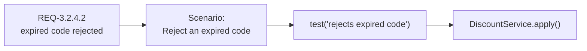
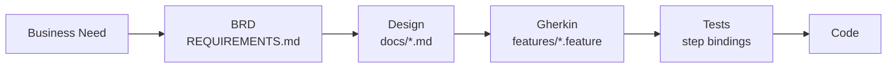
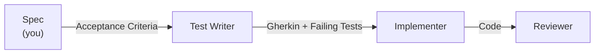
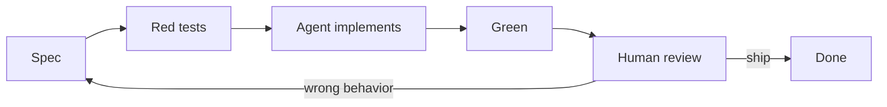
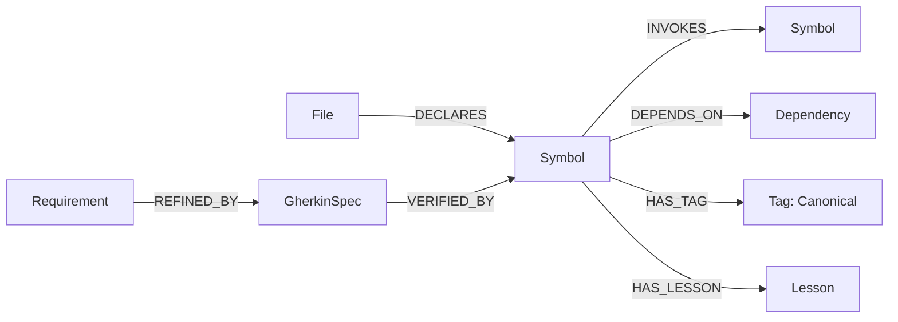

# Specification Driven Development

<div v-click style="margin-top: 1.5rem; font-style: italic; color: #e2b96f; font-size: 1.1rem;">
  The spec is the prompt.
</div>

---
layout: two-cols
layoutClass: gap-16
transition: slide-up
---

# Agenda

::right::

<v-clicks>

- **The spec, then** — what it looked like, why it died
- **The artifacts** — BRD to Gherkin to test to code
- **The loop** — how the agent iterates without you re-prompting, and where the tester goes
- **The graph** — giving the agent your codebase, not just your prose
- **Monday** — what to change first

</v-clicks>

---
transition: fade-out
---

# In the Before Times

<div style="margin: 0.75rem 0 0.5rem;">
  
</div>

<div style="display: grid; grid-template-columns: repeat(4, minmax(0, 1fr)); gap: 1rem; text-align: center;">
  <div>
    <div style="color: #e2b96f; font-weight: 700;">Paper</div>
    <div style="font-size: 0.85rem; opacity: 0.8;">Think it through. Write it down.</div>
  </div>
  <div>
    <div style="color: #e2b96f; font-weight: 700;">Punch cards</div>
    <div style="font-size: 0.85rem; opacity: 0.8;">Make every card count.</div>
  </div>
  <div>
    <div style="color: #e2b96f; font-weight: 700;">The '90s spec</div>
    <div style="font-size: 0.85rem; opacity: 0.8;">The whole system. In a binder.</div>
  </div>
  <div>
    <div style="color: #e2b96f; font-weight: 700;">The Agile era</div>
    <div style="font-size: 0.85rem; opacity: 0.8;">The binder becomes a backlog.</div>
  </div>
</div>

<div style="margin-top: 1.25rem; text-align: center; font-style: italic;">
  Somewhere along the way, we lost the whole picture.
</div>

<!--

A deliberately compressed, satirical history of the artifacts around development, not four mutually exclusive eras. Paper coding sheets and punched cards were often parts of the same workflow. Formal specifications predate the 1990s; that is the era this talk is recalling.

Start with the developer: when running the program was expensive, you thought it through on paper. Then you encoded it on cards. By the '90s, the specification binder promised a complete account of what the system should do. Requirements, constraints, traceability, sign-off. Behold the binder.

Then comes the shredder. This is the joke about what happened in some shops: the binder disappeared, the tickets survived, and the whole-system intent got scattered. Agile itself did not demand the destruction of specifications. The 2001 manifesto values working software over comprehensive documentation and explicitly retains value in documentation.

Source: https://agilemanifesto.org/

Bridge: before we bring the spec back as an agent's input, let's open that old binder and see what was actually useful. Next slide: A Spec, 1998.

-->

---
transition: fade-out
---

# A Spec, 1998

```text
3.2.4  Discount Application

REQ-3.2.4.1  The system SHALL apply a valid discount code to the
             order subtotal prior to payment authorization.
REQ-3.2.4.2  The system SHALL reject a discount code whose expiry
             date precedes the current date and SHALL display
             message MSG-017 ("This code has expired").
REQ-3.2.4.3  The system SHALL NOT apply more than one discount
             code per order.
REQ-3.2.4.4  Orders with a subtotal of $75.00 or greater SHALL
             receive standard shipping at no charge.

Source:       BR-12 (Q3 Promotions)
Verified by:  TC-3.2.4.1, TC-3.2.4.2, TC-3.2.4.3, TC-3.2.4.4
Out of scope: Stacking, gift cards, loyalty points (see 3.2.7)
```

<!--

This is a Functional Requirements Specification. IEEE 830 shape. Every shop had one. Every line is numbered, every line uses SHALL, every line points upstream to a business requirement and downstream to a test case.

Read REQ-3.2.4.2 out loud. That is a test. Written by someone who never wrote a test.

-->

---
transition: fade-out
---

# What It Had, Why It Died

<div grid="~ cols-2 gap-8" m="t-2">
<div>

**Had**

- One ID per claim
- `SHALL` / `SHALL NOT` — no "should probably"
- Traceability both directions: BR ↔ REQ ↔ TC
- Explicit **out of scope**

</div>
<div>

**Died because**

- Humans had to keep it in sync with code
- Nobody did
- Agile buried it: *working software over comprehensive documentation*

</div>
</div>

<v-click>

<div m="t-6">

Now the reader is a machine. It can keep the document in sync. It cannot ask what you meant.

</div>

</v-click>

<!--

Agile didn't say "no spec." It said don't let a stale document outrank running code. The document went stale because maintaining it was human labor. That constraint is gone.

The new constraint: the agent won't Slack you "wait, what does this mean?" It will confidently build the wrong thing.

-->

---
transition: fade-out
---

# TDD, BDD, SDD

<v-clicks>

- **TDD** — test first, code until green
- **BDD** — behavior first, tests fall out of it
- **SDD** — specification first, the agent does the rest

</v-clicks>

<v-click>

Same discipline, one level further upstream. Skip it and you are prompting, not specifying.

</v-click>

<!--

Not a new idea. Same move TDD made in 2003: put the thing that defines "done" before the thing that does it. AI made downstream cheap; upstream is where your time matters now.

One contrast, then move on: prompt-first ("vibe coding") leaves nothing behind. Spec-first leaves the document on the previous slide.

-->

---
transition: slide-up
---

# Same Document, New Reader



<v-clicks>

- The agent walks this chain. It does not invent it
- Each hop is a file in the repo, not a message in a chat
- Change the REQ, re-run the chain — that is the whole workflow

</v-clicks>

<!--

This is the reframe for the rest of the talk. The 1998 spec is not nostalgia. It is the shape of a prompt that produces the same code twice.

-->

---
transition: slide-up
---

# The Artifacts



<v-click>

Every arrow is a file. Files get reviewed, diffed, versioned. Chats don't.

</v-click>

<!--

Upstream is cheap to change; downstream is expensive. A wrong sentence in the BRD costs a sentence. The same mistake in production costs a hotfix.

If a step in your pipeline is not a file, the agent can't read it and the next person can't either.

-->

---
level: 2
---

# Roles as Agents



<v-clicks>

- **Agent** = persona + instructions + tools. Defined once, in the repo
- Each role trusts only the artifact from the role before it, never the chat

</v-clicks>

<!--

Three agents is enough to show the shape. Add roles as your own handoffs demand them.

The spec box stays yours. Everything downstream of it is mechanical.

-->

---
transition: slide-up
---

# Anatomy of a Spec

<v-clicks>

- **Business Goal** — why this exists
- **User Needs** — what they are trying to do
- **Acceptance Criteria** — numbered, falsifiable, `SHALL`
- **Constraints** — performance, legal, platform
- **Out of Scope** — what **not** to build

</v-clicks>

<!--

Out of Scope is the section nobody writes. Without it, an agent over-delivers into territory nobody asked for, and now you review code you never wanted.

-->

---

# Bad Spec vs. Good Spec

<div grid="~ cols-2 gap-4" m="t-2">
<div>

**Bad**

> "Let customers get a discount at checkout."

- No trigger
- No edge cases
- "Checkout" and "discount" undefined

</div>
<div>

**Good**

> Given a cart with a valid, unexpired discount code,<br/>
> when the customer applies it at checkout,<br/>
> then the discount is reflected in the total before payment.

- Names the trigger
- Implies the failure cases
- Already reads like a test

</div>
</div>

<!--

The good version is REQ-3.2.4.1 in Given/When/Then clothes. Same claim, one step closer to executable.

-->

---

# Gherkin

```gherkin
Feature: Checkout discounts

  Scenario: Apply a valid discount code
    Given a cart containing items worth $50
    And the discount code "SAVE10" is valid and unexpired
    When the customer applies "SAVE10" at checkout
    Then the order total is reduced by 10%

  Scenario: Reject an expired discount code
    Given a cart containing items worth $50
    And the discount code "SAVE10" expired yesterday
    When the customer applies "SAVE10" at checkout
    Then the discount is not applied
    And the customer sees an "expired code" message

  Scenario: Free shipping over a threshold
    Given a cart containing items worth $75
    When the customer proceeds to checkout
    Then shipping is free
```

<!--

REQ-3.2.4.1, .2, .4 — one scenario each. No database, no endpoint, no class name. Still spec.

-->

---

# Gherkin → Test, Line by Line

<div grid="~ cols-2 gap-4" m="t-2">
<div>

```gherkin
Scenario: Apply a valid
  discount code
  Given a cart containing
    items worth $50
  And the discount code
    "SAVE10" is valid
    and unexpired
  When the customer applies
    "SAVE10" at checkout
  Then the order total is
    reduced by 10%
```

</div>
<div>

```ts
test(
  "applies a valid discount code",
  () => {
    const cart = givenCart(50)
    givenDiscountCode(
      "SAVE10",
      { expired: false }
    )

    applyDiscount(cart, "SAVE10")

    expect(cart.total)
      .toBe(45)
  }
)
```

</div>
</div>

<!--

Given = setup. When = action. Then = assert. No creative liberty required, none allowed. That is what makes it safe to hand to an agent.

-->

---
transition: slide-up
---

# The Loop



<v-clicks>

- AI code is not trusted. It is **verified** against scenarios a human already approved
- Wrong behavior? Fix the **spec**, re-run. Do not argue with the chat
- The spec delta is the commit message

</v-clicks>

<!--

The correction goes into a file that outlives the session. Next run starts from the corrected spec, not from a blank prompt.

-->

---
level: 2
---

# The Tester, Then and Now

<div grid="~ cols-2 gap-8" m="t-2">
<div>

**Then**

- Gets the build last
- Writes test cases from the story, after the code
- Test plan is its own document. Drifts from both
- Bug → ticket → fix → full regression pass. Every release

</div>
<div>

**Now**

- Gets the spec first. AC review is the first test pass
- Their edge cases become scenarios. `B-003` gets its `S-004`
- Scenario **is** the test case **is** the requirement. One artifact
- Bug → spec delta + scenario → agent fixes → regression regenerated

</div>
</div>

<v-click>

<div m="t-6">

The tester's job was always finding the gap between what was meant and what was built. Now they close it before the build exists.

</div>

</v-click>

<!--

Under the old model the tester was downstream of every decision and paid for all of them. The bug report was the only artifact they owned, and it arrived after the expensive part.

Under SDD they own the artifact the agent consumes. The Missing row on the traceability slide is a tester's bug report, filed before implementation. Same skill, cheaper place to spend it.

-->

---
level: 2
---

# Where Manual Effort Goes

<v-clicks>

- **Not** the regression pass. Scenarios run it. Every commit, not every release
- `Missing` rows in the traceability matrix. Coverage gaps are the test plan
- Blast radius from the graph query. Test what the change touches, not the whole app
- Exploratory testing. Feel, flow, the path nobody wrote a scenario for
- Every exploratory find becomes a scenario. Next run it is automated

</v-clicks>

<v-click>

Automation eats the checklist. Judgment is what remains, and it feeds the spec.

</v-click>

<!--

The regression suite used to grow by hand and the manual pass got longer every quarter. Now it grows by scenario and the agent runs it.

What the machine cannot do is notice that the flow feels wrong, or try the thing no one specified. That is the tester's upstream skill, and it does not get automated away. It gets written down as a scenario and never has to be found twice.

-->

---
level: 2
---

# Technique: Traceability as a Gate

| Claim | Prose | Scenario | Status |
| --- | --- | --- | --- |
| `B-001` | Valid code reduces total | `S-001` | Covered |
| `B-002` | Expired code rejected with message | `S-002` | Covered |
| `B-003` | Only one code per order | — | **Missing** |
| `B-004` | Free shipping at $75 | `S-003` | Covered |

<v-clicks>

- Every claim maps to a scenario. Every scenario maps back to a claim
- `Missing` blocks implementation. The agent enforces it, not you
- Matrix is generated from the artifacts, not maintained by hand

</v-clicks>

<!--

1998 had this as a spreadsheet nobody updated. Now the agent builds it on every run and refuses to proceed with a Missing row.

B-003 is the one that ships as a bug when nobody checks. Here it never reaches the implementer.

-->

---
level: 2
---

# Technique: Reviewer Judges Against the Spec

<v-clicks>

- Reviewer agent gets the spec, the scenarios, and the diff
- Question is not "is this good code?" — it is "does this satisfy `B-001`..`B-004` and nothing else?"
- Scope creep is a finding. Untraced behavior is a finding
- Findings go back as spec deltas or test deltas, never as chat replies

</v-clicks>

<!--

Taste-based review is where humans disagree and agents hallucinate. Spec-based review is a checklist. Both are more consistent when the bar is written down.

-->

---
level: 2
---

# Technique: Lessons Flow Upstream

```markdown
## Lesson: Discount rounding
- Symptom: $49.99 cart, 10% code, total showed $44.99 in UI, $44.991 in API
- Root cause: rounding applied in view layer only
- Spec delta: REQ-3.2.4.5 — totals SHALL be rounded to cents
  at the domain boundary
- Scenario: S-005 added
```

<v-clicks>

- Bug fixed but spec unchanged = same bug next quarter
- Lesson file is read by the agent on every design pass
- Memory that survives the session, the branch, and the model swap

</v-clicks>

<!--

STORY: TODO — a bug that got patched, spec never updated, bit someone again.

If code and spec disagree, that is a process bug. Fix the spec, let it flow back down.

-->

---
transition: slide-up
---

# Where Agents Fall Down

<v-clicks>

- Context window is small. Your codebase is not
- `grep` is flat: it finds a name, not what depends on it
- Agent reinvents `DiscountService` because it never saw the one that exists
- Design advice with no evidence is a guess with confidence

</v-clicks>

<v-click>

The spec says **what**. The agent still needs **what already exists and how it connects**.

</v-click>

<!--

This is the ceiling on spec-alone SDD. A perfect spec plus a blind agent still produces duplication and drift. The fix is giving the agent structure, not more prose.

-->

---
level: 2
---

# Code as a Graph



<v-clicks>

- Parse the repo into nodes and edges. Load into a graph database
- Specs, scenarios, and lessons are nodes too — same graph as the code
- Traceability stops being a spreadsheet. It is a path query

</v-clicks>

<!--

Symbol = class, method, property. Edges are the things grep cannot tell you: who calls this, what breaks if it changes, which scenario proves it.

"Canonical" tag = the reference implementation. The agent copies that one, not whichever it found first.

-->

---
level: 2
---

# Query: Which Specs Have No Test?

```cypher
MATCH (spec:GherkinSpec)
WHERE NOT (spec)-[:VERIFIED_BY]->(:Symbol)
RETURN spec.name, spec.filePath
```

<v-click>

```cypher
// What breaks if I touch this?
MATCH (b:Behavior)-[:DEPENDS_ON*1..3]->(core:Symbol {fqn: $fqn})
RETURN DISTINCT b.name, b.type
```

</v-click>

<v-click>

Run before implementation. Empty result = gate passes. Rows = agent stops and reports.

</v-click>

<!--

First query is the traceability matrix, as one statement. Second is impact analysis: the agent knows the blast radius before it writes a line.

Bound the depth. Unbounded `[*]` on a real codebase will not come back.

-->

---
level: 2
---

# Query: Show Me the Canonical Example

```cypher
MATCH (s:Symbol)-[:HAS_TAG]->(t:Tag {name: "Canonical"})
WHERE s.namespace CONTAINS $domainTerm
RETURN s.fqn, s.kind, s.filePath
LIMIT 10
```

<v-clicks>

- Run before the implementer writes a line
- Result rows ship **with** the design — query text and output, verbatim
- Test writer and implementer see the same evidence. Nobody guesses

</v-clicks>

<!--

This is the lift. Every design choice cites a real symbol in the graph or a recorded lesson. If it can't cite one, it says so.

Downstream agents can re-run the query. Evidence is reproducible, not paraphrased.

-->

---
transition: slide-up
---

# The Lift

<div grid="~ cols-2 gap-8" m="t-2">
<div>

**Spec alone**

- Correct behavior
- Blind to existing code
- Duplication, drift
- Review by taste

</div>
<div>

**Spec + graph**

- Correct behavior
- Cites what exists
- Reuses the canonical example
- Review by traceability query

</div>
</div>

<v-click>

<div m="t-6">

Same agent. Same model. Same prompt. Different inputs.

</div>

</v-click>

<!--

The model is not the variable. What you feed it is. A 1998 spec and a graph of your own codebase beat a bigger model with a vague prompt.

-->

---
transition: slide-up
---

# Monday

<v-clicks>

- No spec? Write one before the prompt. Numbered claims. `SHALL`. Out of scope
- Gherkin before implementation when requirements are fuzzy
- Correct the spec, not the chat
- Testers review the AC before the agent sees it. Their bugs become scenarios
- Put the artifacts in the repo. Put the repo in a graph
- The upstream skill is the one that does not get automated away

</v-clicks>

<!--

You will spend more of your career writing what "done" means than typing what an agent can generate. Get good at the part the agent consumes.

-->

---
layout: center
class: text-center
transition: fade-out
---

# Thank You

<div style="margin-top: 2rem; color: #e2b96f; font-size: 1rem; font-style: italic;">
  Say what you mean. Write it down. Let the machine read it.
</div>
