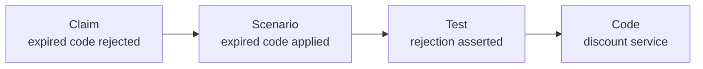
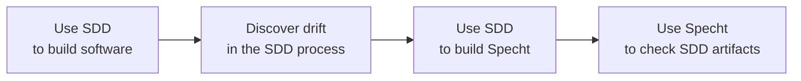
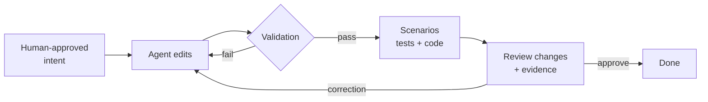
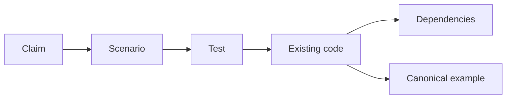

# Specification Driven Development

<div v-click style="margin-top: 1.5rem; font-style: italic; color: #e2b96f; font-size: 1.1rem;">
  The spec is the prompt. Who checks the spec?
</div>

<!--
Timing: 0.5 minutes. The specification returns: 6 minutes total, slides 1–6.

The spec is the prompt. That was the premise of the first iteration of this talk. Using it gave me a horror story: a review loop that ate a week's worth of tokens. My precious tokens. We will get to what happened and why I built Specht as a result.

Keep the published promise in view: explicit specifications guide agents, and tests, lessons, and skills keep the workflow honest. The new question is how we check the reference the agents rely on.
-->

---
layout: two-cols
layoutClass: gap-16
transition: slide-up
---

# Agenda

::right::

<v-clicks>

- **The spec returns** — same discipline, new reader
- **The agent workflow** — what it reads and hands off
- **My precious tokens** — when author and reviewer drift
- **Specht** — a deterministic check in the loop
- **Start today** — the process you can take home

</v-clicks>

<!--
Timing: 0.5 minutes.

We will keep the history brief, follow one checkout claim through the agent workflow, and use my experience as the turning point. The longest worked section shows how a deterministic check interrupts a mechanical failure. We finish with installation and the principle you can apply with any tool. Reserve the last three minutes for questions.
-->

---
transition: fade-out
---

# In the Before Times

<div style="margin: 0.75rem 0 0.5rem;">
  
</div>

<div style="display: grid; grid-template-columns: repeat(4, minmax(0, 1fr)); gap: 1rem; text-align: center;">
  <div>
    <div style="color: #e2b96f; font-weight: 700;">Paper</div>
    <div style="font-size: 0.85rem; opacity: 0.8;">Think it through. Write it down.</div>
  </div>
  <div>
    <div style="color: #e2b96f; font-weight: 700;">Punch cards</div>
    <div style="font-size: 0.85rem; opacity: 0.8;">Make every card count.</div>
  </div>
  <div>
    <div style="color: #e2b96f; font-weight: 700;">The '90s spec</div>
    <div style="font-size: 0.85rem; opacity: 0.8;">The whole system. In a binder.</div>
  </div>
  <div>
    <div style="color: #e2b96f; font-weight: 700;">The Agile era</div>
    <div style="font-size: 0.85rem; opacity: 0.8;">The binder becomes a backlog.</div>
  </div>
</div>

<div style="margin-top: 1.25rem; text-align: center; font-style: italic;">
  Somewhere along the way, we lost the whole picture.
</div>

<!--

Timing: 1 minute.

A deliberately compressed, satirical history of the artifacts around development, not four mutually exclusive eras. Paper coding sheets and punched cards were often parts of the same workflow. Formal specifications predate the 1990s; that is the era this talk is recalling.

Start with the developer: when running the program was expensive, you thought it through on paper. Then you encoded it on cards. By the '90s, the specification binder promised a complete account of what the system should do. Requirements, constraints, traceability, sign-off. Behold the binder.

Then comes the shredder. This is the joke about what happened in some shops: the binder disappeared, the tickets survived, and the whole-system intent got scattered. Agile itself did not demand the destruction of specifications. The 2001 manifesto values working software over comprehensive documentation and explicitly retains value in documentation.

Source: https://agilemanifesto.org/

Bridge: before we bring the spec back as an agent's input, let's open that old binder and see what was actually useful. Next slide: A Spec, 1998.

-->

---
transition: fade-out
---

# A Spec, 1998

```text
3.2.4  Discount Application

REQ-3.2.4.1  The system SHALL apply a valid discount code to the
             order subtotal prior to payment authorization.
REQ-3.2.4.2  The system SHALL reject a discount code whose expiry
             date precedes the current date and SHALL display
             message MSG-017 ("This code has expired").
REQ-3.2.4.3  The system SHALL NOT apply more than one discount
             code per order.
REQ-3.2.4.4  Orders with a subtotal of $75.00 or greater SHALL
             receive standard shipping at no charge.

Source:       BR-12 (Q3 Promotions)
Verified by:  TC-3.2.4.1, TC-3.2.4.2, TC-3.2.4.3, TC-3.2.4.4
Out of scope: Stacking, gift cards, loyalty points (see 3.2.7)
```

<!--

Timing: 1 minute.

This is an illustrative 1990s-style Functional Requirements Specification. The numbered claims, SHALL language, upstream source, and downstream test references are the useful parts. It is a fictional checkout example, not a historical document or a claim of compliance with a particular standard.

Read REQ-3.2.4.2 out loud. That is a test. Written by someone who never wrote a test.

-->

---
transition: fade-out
---

# What It Had, Why It Drifted

<div grid="~ cols-2 gap-8" m="t-2">
<div>

**Had**

- One ID per claim
- `SHALL` / `SHALL NOT` — no "should probably"
- Traceability both directions: BR ↔ REQ ↔ TC
- Explicit **out of scope**

</div>
<div>

**Maintenance cost**

- People reconciled documents and code
- Stale requirements could survive reviews
- Intent became scattered across tickets

</div>
</div>

<v-click>

<div m="t-6">

Now agents can help maintain it. Their edits need verification too.

</div>

</v-click>

<!--

Timing: 1 minute.

The document could go stale because keeping it aligned was expensive. Agents can help with that work, but their edits are not self-verifying. A machine reader can ask questions when instructed; it can also proceed confidently from the wrong interpretation. Do not assume it has understood or preserved the intent.

Keep the distinction from the history slide: Agile values working software over comprehensive documentation; it does not demand that teams discard specifications. The failure is letting an unchecked document outrank reality. Our new failure will be letting an unchecked agent edit redefine that document.

Source: https://agilemanifesto.org/

-->

---
transition: fade-out
---

# The Spec Is Back

<div style="margin: 0.75rem 0 0.5rem;">
  
</div>

<div style="display: grid; grid-template-columns: repeat(3, minmax(0, 1fr)); gap: 1rem; text-align: center;">
  <div>
    <div style="color: #e2b96f; font-weight: 700;">Old busted</div>
    <div style="font-size: 0.95rem; font-weight: 600;">The specification</div>
    <div style="font-size: 0.85rem; opacity: 0.8;">Write it. File it. Forget it.</div>
  </div>
  <div>
    <div style="color: #e2b96f; font-weight: 700;">New hotness</div>
    <div style="font-size: 0.95rem; font-weight: 600;">AI chat</div>
    <div style="font-size: 0.85rem; opacity: 0.8;">Prompt it. Patch it. Repeat.</div>
  </div>
  <div>
    <div style="color: #e2b96f; font-weight: 700;">Old busted hotness</div>
    <div style="font-size: 0.95rem; font-weight: 600;">The spec drives the agent</div>
    <div style="font-size: 0.85rem; opacity: 0.8;">Specify it. Test it. Regenerate.</div>
  </div>
</div>

<div style="margin-top: 1rem; text-align: center; font-style: italic;">
  Same discipline. New reader.
</div>

<!--

Timing: 2 minutes.

Verbal riff on the Men in Black old-gear/new-gear joke, illustrated with ordinary developers in clothes appropriate to their era and age. The third label is the talk's punchline: "old busted hotness."

Old busted: the specification we just opened. Useful structure, but maintaining it by hand was expensive. The dusty binder is the failure mode, not the goal.

New hotness: ask AI for code. It feels like a superpower. But when intent lives only in a chat, you keep steering, patching, and repeating yourself. The middle panel satirizes that prompt-first workflow, not every use of AI chat.

Old busted hotness: the spec comes back as a versioned artifact the agent actually consumes. Numbered claims, acceptance criteria, constraints, and out of scope. Scenarios and tests check the implementation against those claims. Update the spec, review the delta, and run the workflow again.

The comeback is explicit intent that agents consume in a versioned workflow. Humans decide what the system should do and review changes to that intent. Tests, lessons, skills, and deterministic checks support the handoffs; none makes an agent infallible.

Pause on the third label, then land: same discipline, new reader. Next slide puts TDD, BDD, and SDD on that continuum.

-->

---
transition: fade-out
---

# TDD, BDD, SDD

<v-clicks>

- **TDD** — failing test, implementation, refactor
- **BDD** — agreed behavior, scenarios, executable checks
- **SDD** — explicit intent guides the agent's work

</v-clicks>

<v-click>

Each gives the next step something concrete to check against.

</v-click>

<!--
Timing: 1 minute. How agents use the spec: 8 minutes total, slides 7–10.

Keep this connection from the original talk. SDD belongs alongside disciplines the audience already knows. We still need good tests and shared understanding. Writing intent upstream gives the agent a durable input, but does not make everything downstream automatic or correct.

The important change is where the next task starts: from agreed behavior and constraints rather than a fresh explanation in every chat. Tests, design choices, and code still require judgment. Next, follow one requirement through those handoffs.
-->

---
transition: slide-up
---

# Same Document, New Reader



<v-clicks>

- **Read:** approved intent, constraints, and existing code
- **Produce:** a scoped change linked to the claim
- **Hand off:** the diff, check results, and unresolved questions

</v-clicks>

<!--
Timing: 2 minutes.

The requirement from the old binder still has a job. The agent reads the rule, works out scenarios, implements a test and code, and carries the reference forward. These artifacts express related things; they are not interchangeable. A scenario describes an example, a test executes an assertion, and code delivers behavior.

The contract is that each role can inspect where its input came from. The links make that inspection possible. A versioned file preserves the reference across sessions, but version control cannot tell us that a sentence is true. Keep that distinction in mind; it is where this story goes wrong.

A change to the requirement triggers review of affected scenarios, tests, and code. It does not guarantee the agent will regenerate the same implementation twice.
-->

---
level: 2
---

# Roles as Agents

| Role | Reads | Produces |
| --- | --- | --- |
| Spec author | Human intent, current spec | Proposed spec delta |
| Test writer | Approved claims, constraints | Scenarios and failing tests |
| Implementer | Spec, tests, existing code | Scoped implementation |
| Reviewer | Approved baseline, all diffs, evidence | Findings tied to claims |

<v-click>

Instructions define the handoff. Tools check its explicit rules.

</v-click>

<!--
Timing: 2 minutes.

An agent role is a persona, instructions, and tools. The table describes a workflow contract, not a requirement for four separate sessions. You can use fewer agents and still preserve the responsibilities.

Notice that the spec author may be an agent too. I still own the intent. The author proposes changes; it does not get authority to redefine the requirement silently. The reviewer needs the approved baseline as well as the new spec. Otherwise, what prevents both roles from agreeing on a new requirement I never asked for?

For now, this looks reasonable. We have roles, files, tests, and a review. We have all the ingredients for a responsible workflow. That is what made the failure so frustrating.
-->

---
layout: two-cols
layoutClass: gap-8
---

# One Claim Through the Loop

**Claim `AC-002`**

Reject an expired discount code and show an expired-code message.

**Constraint:** rejection happens before payment.

**Out of scope:** stacking discount codes.

::right::

```gherkin
@AC-002
Scenario: Reject an expired code
  Given a cart worth $50
  And SAVE10 expired yesterday
  When SAVE10 is applied
  Then the total remains $50
  And an expired-code message appears
```

The test must execute these assertions.

<!--
Timing: 3 minutes.

This is the condensed spec anatomy and Gherkin example. The business goal is clear checkout pricing. The user needs feedback when a code cannot be used. The claim is falsifiable, the constraint sets a boundary, and out of scope limits what the agent should add. We are keeping the checkout example from the existing talk.

For the modern examples, AC-002 is our short claim identifier for the expired-code requirement previously shown as REQ-3.2.4.2. This is an explicit presentation mapping, not an instruction to renumber real requirements. The tag carries that identity into the scenario. The test needs assertions for both the unchanged total and the message. A descriptive test name alone proves neither.

Ask the audience to consider what happens if the tag disappears, then what happens if the author changes 'reject' to 'accept.' Those are different failures. One concerns the relationship; the other concerns the intent. Next comes the story of trusting this loop too far.
-->

---
layout: center
class: text-center
transition: fade
---

# My Precious Tokens

<div style="margin-top: 2rem; font-size: 1.8rem; line-height: 1.5; color: #e2b96f;">
  “Claude Max ate a week's worth of tokens<br/>trying to review a pull request.”
</div>

<div style="margin-top: 1.5rem; opacity: 0.75;">A real review loop in one of my projects</div>

<!--
Timing: 1 minute. The token horror story: 10 minutes total, slides 11–16.

This is my account of what happened. The quote describes my experience with the review cycle, not a benchmark of Claude or a measured comparison between tools. Do not add a dollar amount, an iteration count, or a claim about how long the PR ran.

Pause after 'my precious tokens.' I had the spec. I had an author. I had a reviewer. And the thing consuming my tokens was the process that was supposed to keep the work honest. This is the horror story promised in the opening.
-->

---
transition: slide-up
---

# The Files Behind the Workflow

Each feature keeps a **`.spec/` folder beside its code**.

| Artifact | What the agent learns |
| --- | --- |
| `README.md` | Claims, constraints, scope, and traceability |
| `*.feature` | Concrete behavior scenarios linked to claims |
| `adr/` | Architecture Decision Records: the technical choice and why |
| `decisions/` | Product and scope choices, including rejected options |
| `lessons/` | What failed, why, and what changed in the spec or procedure |

**`.specht/` is separate:** checker configuration, schemas, and starter templates.

Agents read the agreements and reasoning. Specht checks explicit rules.

<!--
Timing: 1.5 minutes.

Before introducing the checker, give the audience a map of the files it works around. These are two different folder names: dot-spec contains the specification and its supporting records; dot-specht contains the tool's configuration, schemas, and templates. Neither is a .NET SDK installation folder. A .NET tool is the packaging mechanism for the checker.

A feature's .spec/README.md is its agreement: numbered claims, constraints, out of scope, design, traceability, and sign-off. Its companion .feature file gives concrete behavior examples linked to those claims. Those scenarios become executable checks when test bindings implement them and the runner executes them.

ADR means Architecture Decision Record. It keeps the context, alternatives, technical decision, and consequences so the next agent does not reopen a settled design as an unexplained gap. A product decision record instead preserves what we chose to build or exclude and why. A lesson records an observed failure, root cause, and follow-through: a product lesson changes the relevant claim/scenario when needed; a process lesson changes the reusable procedure or skill. Agents must retrieve and apply the relevant records; their existence alone does not change model behavior.

These paths are relative to a feature's .spec/ folder. Records that apply across features belong in the repository-root .spec/adr/ or .spec/lessons/ instead. Scope determines where the record lives. This is an orientation, not a tour of every required heading.

.specht/manifest.json configures the checker and its schema selection; .specht/schema/ stores schemas; .specht/templates/ stores starter documents supplied by init --all. Templates are blanks to fill and place with the relevant feature, not finished specifications. Installing Specht does not author the requirements, bind scenarios, run behavioral tests, or configure agent handoffs for us. The base checker validates selected rules on specifications and their relationships; it does not read adr/, decisions/, or lessons/ to establish their truth.

Sources: https://github.com/RLittlesII/specht/blob/main/docs/setup.md ; https://github.com/RLittlesII/specht/blob/main/docs/what-it-checks.md ; https://github.com/RLittlesII/specht/tree/main/.specht/templates
-->

---
transition: slide-up
---

# What Is a Claim?

A **numbered, testable acceptance criterion**: what the system must do.

**Example phrasing — the intended replay behavior**

```text
AC-011: If the store is busy or unreadable, report an
       environment failure and exit with category 3.
```

- **ID:** `AC-011` gives that agreement a stable reference
- **Scenario:** a concrete example that exercises the claim
- **Traceability:** the links from the claim to its scenarios and tests

The ID names the agreement. It does not prove the wording is right.

<!--
Timing: 1.5 minutes.

AC stands for acceptance criterion. For consistent presentation, the audience-facing deck uses AC- identifiers; the source repository uses B-. Thus B-011 is displayed as AC-011, and B-003 as AC-003. This is a presentation mapping, not a recommendation to renumber existing repository IDs. Original identifiers remain in pr-evidence.md and the source-specific notes.

A claim is an individual requirement we can challenge with evidence, not a vague aspiration such as 'replay should work well.' Its identifier lets authors, scenarios, tests, and reviewers refer to the same agreement. IDs are stable within their feature; a full reference includes the feature when we cross its boundary. B-011 in one feature need not mean B-011 in another.

The displayed wording is a simplified explanation of the intended behavior, not a verbatim historical excerpt. The actual replay case distinguishes an environment failure, category 3, from a rejected request, category 1. We need only that distinction to understand the next slide. We are not teaching the entire replay design.

A scenario gives a concrete input and expected result. A traceability row records which scenarios and tests relate to the claim. An existing row is not proof that its test runs, passes, or asserts the right thing. Likewise, a valid ID cannot make incorrect wording true.

Set up the drift: what happens if the claim says category 1 while the design says category 3, and a downstream test author copies the claim? That is the actual incident on the next slide. Keep the reference stable, review changes to meaning, and check the relationships mechanically where possible.

Source provenance for the actual exit-category contradiction: pr-evidence.md, 'A wrong claim propagated into a scaffold.' This slide's short requirement sentence is explanatory phrasing.
-->

---
transition: fade-out
---

# The Spec Started Drifting

**Actual review evidence: a replay command**

| Same failure: store busy or unreadable | Exit category |
| --- | --- |
| Revised claim `AC-011` | **1** |
| Design § 7, `R3` / `R13` | **3** |
| Test stub's expected result | **1** |

```cs
// Then a structured failure is reported and the exit code is category 1
```

The incorrect claim propagated into the test scaffold.


<!--
Timing: 2 minutes.

This is actual PR evidence from a private project. The project was changing its replay write path to an append-only request consumed later by the daemon. The domain detail we need: a busy or unreadable store is an environment failure, which the design maps to exit category 3.

At reviewed commit fdbae932c81169920f2e3d2eba0f8b2f676e838f, feature 0005-F5b's revised B-011 included store/config preconditions and busy-timeout in category 1. The same spec's § 7 R3/R13, domain row, and diagrams mapped StoreBusy/StoreUnreadable to category 3. The staged test copied the category-1 expectation. The line on screen is verbatim from ReplayCommandHandler.Unit.Tests.cs:153 at that commit. This was a scaffold: its body called Assert.Fail("not implemented — scaffold only"). Do not describe it as a passing executable test or a shipped production bug.

The review explicitly identified that the stub inherited the wrong reading. It caught this contradiction; the evidence does not show that every reviewer blindly accepted the spec. My account supplies the broader author/reviewer cycle and token cost. GitHub supplies concrete contradictory artifacts and remediation history.

Source provenance: see pr-evidence.md for the reviewed artifacts, original PR identifiers, and pinned source links.
-->

---
transition: slide-up
---

# The References Drifted Too

**Actual review evidence: the original and follow-up PRs**

- **Original PR:** five accepted claims, zero traceability rows
- **Follow-up PR:** scenario tagged `@AC-011`; the spec says `AC-003` governs it
- **Follow-up PR:** the scenario appeared under neither claim in § 9

**The verified correction — IDs shown as `AC-`**

```diff
-    @AC-011
+    @AC-003
```

The correction also added the scenario to `AC-003`'s traceability row.


<!--
Timing: 2 minutes.

These are separate findings across the two PRs, not one invented diff. In #214, the review of 0001-F4 found five accepted claims B-001–B-005 with no § 9 rows. The document argued that rows would wait for scenarios, but the contract required one row per claim even when its test was marked Missing. An explicit gap and an absent row are different states.

In #215, the replayed-secret-failure scenario had already been rewritten to describe a later listing of an attempt's failure. Its tag still said B-011. The spec's own B-011 text now assigned that behavior to B-003, yet neither claim's § 9 entry listed the scenario. Both IDs existed. Merely checking whether a tag resolves would not catch assignment to the wrong claim; the human semantic finding determines the intended assignment.

At reviewed commit 4e95b5b7bdddeab266f8d0f7631b0a13307ca76d, the feature tag was @B-011 at line 110, and the two matrix rows omitted the scenario. Correction commit 90ab1fed669bcae50b5bafad159bc59583a2f1cd retagged it @B-003, added the scenario title to B-003's row, and reconciled related citations. The diff on screen preserves the actual tag correction, with B- prefixes displayed as AC- and the unchanged scenario title omitted for readability.

This shows the distinction needed for Specht: missing required rows can be checked mechanically. Determining which valid claim describes a scenario's meaning still needs review. Do not claim Specht automatically diagnoses the semantic misassignment just because it can validate references.

Source provenance: see pr-evidence.md for the reviewed artifacts, original PR identifiers, and pinned source links.
-->

---
layout: center
class: text-center
transition: fade
---

# Author. Reviewer. Author. Reviewer.

| The visible repair history | What followed |
| --- | --- |
| Original PR: repeated spec and traceability repairs | Closed without merging |
| Follow-up PR: further review and corrections | Eventually merged |

<div style="margin-top: 1rem; font-size: 1.3rem; color: #e2b96f;">My precious tokens were disappearing.</div>

<v-click>

> “…a reminder of what to do when AI goes rogue!”

My closing comment on the original PR


</v-click>

<!--
Timing: 2 minutes.

The repair history is visible; the token bill is my reported experience. PR #214 contains repeated review-remediation commits, including d25739a (review feedback), 0aa4962 (traceability rows), and d953cac (lesson-register integrity collapse). It was closed without merging. The slide quotes an excerpt of my closing comment, omitting the PR identifier. The full comment is preserved in pr-evidence.md.

PR #215 continued with spec, feature-file, and scaffold changes, received further change requests, and ultimately merged on October 7, 2026. This was not an endless unresolved PR: show the eventual outcome as well as the failure. Do not equate the number of GitHub review events, replies, or commit messages with a verified count of internal model-review rounds. The retained history includes rewritten/squashed material.

I had used SDD to build software and encountered a failure in that very process. I then used SDD again to build a tool for SDD. That is the Inception connection coming next. A deterministic checker would take repeated explicit relationship checks out of the model conversation; it would not settle the exit-category semantics or guarantee a smaller token bill.

Source provenance: see pr-evidence.md for the reviewed artifacts, original PR identifiers, and pinned source links.
-->

---
transition: slide-up
---

# Meet Specht


<div style="max-width: 530px;">

A .NET tool that checks your feature specifications and their relationships.

<v-clicks>

- IDs and references
- Required traceability relationships
- Schema and section structure
- Dependency consistency

</v-clicks>

<div style="margin-top: 1.5rem; color: #e2b96f;">Same inputs and pinned rules. Repeatable findings.</div>

[github.com/RLittlesII/specht](https://github.com/RLittlesII/specht)

</div>

<!--
Timing: 1.5 minutes. Building a way out: 11 minutes total, slides 17–22.

Specht grew from my need to stop this cycle. It checks explicit rules against the spec tree and reports violations. The checker runs offline; pinning the tool and schema versions keeps the rule set reproducible across machines and CI.

Keep the description narrow. It does not understand whether accepting expired codes serves the business. It can check whether claims have the expected IDs and traceability relationships, whether feature tags resolve, and whether declared dependencies agree.

The callback: my precious tokens should go toward reasoning that needs a model, while a deterministic checker handles the rules it can enforce. This is a design choice about the workflow, not a measured claim about savings.

Source: https://github.com/RLittlesII/specht (README: checker, pinned schema, supported checks).
Logo: existing dark-background SVG from Specht's .assets/logos/specht-book-logo-dark.svg, reused unchanged.
-->

---
transition: slide-up
---

# SDD Inception



<v-clicks>

- SDD exposed a problem in my SDD process
- SDD then guided the tool I built for SDD
- Specht's own rules still need review and tests

</v-clicks>

<!--
Timing: 1.5 minutes.

This is SDD Inception: I used specification-driven development, discovered drift in the process, then used specification-driven development to create a tool for specification-driven development. Let that nesting be the joke. The point is the method being applied to improve the method itself.

The need was concrete: preserve the structural contract so agents could proceed with useful evidence. Specify the checks, test valid and broken inputs, build the checker, and apply it to the artifacts in the workflow. The diagram expresses that relationship, not a claim that the PRs contain every step of Specht's implementation history.

The checker is software too. Its rules can be wrong or incomplete, so those rules need review and tests. Moving a check out of an LLM gives us a reproducible verdict for that rule; it does not make the rule infallible.

-->

---
transition: fade-out
---

# A Claim Loses Its Traceability Row

**Illustrative reconstruction — excerpts from a checkout spec**

```markdown
## 3. Behavior
AC-002: Reject expired codes and show an expired-code message.
```

```diff
 ## 9. Traceability
 | Claim | Test |
 | --- | --- |
- | AC-002 | RejectExpiredCode |
```

The claim survives. Its test relationship disappears.

<!--
Timing: 2 minutes.

Use the same expired-code claim. We are showing excerpts, not a complete valid Specht document or a runnable fixture. The table and test label are simplified for presentation. Assume the remaining document and all other relationships are valid.

Walk through the loss slowly. The requirement still exists in section 3. The row connecting it to its test disappears from section 9. This is different from a test failing. We have lost a declared relationship before we even ask what the test does.

This is the kind of mechanically detectable drift we can stop passing between author and reviewer. The following slide shows the documented diagnostic shape for this class of error. Its example identifier follows the documentation, with its B- prefix displayed as AC- for consistency.

Source: https://github.com/RLittlesII/specht/blob/main/docs/cli.md (SPEC031 example).
-->

---
transition: fade-out
---

# A Diagnostic the Agent Can Act On

```sh
dotnet specht
```

**Documentation example — IDs shown as `AC-`**

```text
src/specht/.spec/README.md(214)
```

**Rule and message, displayed on separate lines for readability**

```text
error SPEC031:
§ 9 has no row for claim AC-007 [AC-007]
```

<v-click>

The relationship check failed. Return the finding before the next handoff.

</v-click>

<!--
Timing: 2 minutes.

The README documents one diagnostic line containing the file, line, severity, rule ID, message, and claim identifier. It is split here to make it readable from the back of the room. It is not captured output from a command run for this talk.

The documented example names B-007, displayed here as AC-007; our checkout reconstruction uses AC-002. Do not imply these are the same source file or a historical run. They illustrate the same missing-row rule. Point at each part: where to edit, which rule failed, and which claim is affected.

The finding is concrete enough to give the author a bounded task. The orchestrator or CI must honor the failed check; merely printing a diagnostic does not stop another agent from continuing. We will make that handoff explicit in the workflow.

Source: https://github.com/RLittlesII/specht#readme (documented SPEC031 line). The diagnostic is adapted with display wrapping and the B- claim prefix shown as AC-.
-->

---
transition: fade-out
---

# Restore the Relationship

**Illustrative correction — preserve the approved claim**

```diff
 ## 9. Traceability
 | Claim | Test |
 | --- | --- |
+ | AC-002 | RejectExpiredCode |
```

<v-clicks>

- Confirm the referenced test exists and checks the intended behavior
- Restore the link; do not erase the claim to silence the finding
- Run validation again, then run the relevant tests

</v-clicks>

<!--
Timing: 2 minutes.

This continues the simplified checkout reconstruction, not a full Specht fixture. Restore the relationship without changing the approved expired-code rule. A checker finding is not permission to delete the requirement that caused it.

A traceability row names a test, but that name is not enough. Review the test and run it. If the test does not exist yet, record the gap explicitly and complete the required test work before claiming readiness. Do not invent evidence to obtain a passing report.

The bounded loop is now: consume the diagnostic, make the relevant correction, and rerun the check. We still review the correction. We have simply stopped asking the model to rediscover this particular relationship rule on every review pass.
-->

---
transition: fade-out
---

# The Check Passes. The Workflow Continues.

**Illustrative outcome — assuming all other checks pass**

```sh
dotnet specht
```

| Stage | Before | After correction |
| --- | --- | --- |
| Traceability check | Missing row reported | Relationship restored |
| Checker exit | Failure | Success (`0`) |
| Next handoff | Blocked by workflow | Eligible to continue |

<v-click>

Passing the checker is one piece of evidence. Tests and review still follow.

</v-click>

<!--
Timing: 2 minutes.

This is an expected outcome for the reconstruction, not captured terminal output or a claim that adding any row makes a repository pass. All remaining checks must pass too. We deliberately show an outcome table instead of fabricating a full report with counts and paths.

The responsible workflow blocks the next handoff while the required check fails. Once corrected, downstream work can proceed with evidence of structural consistency. That does not demonstrate behavioral correctness. The associated test must execute, and its assertions and the spec delta still need review.

Land the intervention callback: my precious tokens no longer need another conversation to decide whether this required row exists. We have not measured savings here; we have assigned a mechanical check to a program with a reproducible outcome.

Source: https://github.com/RLittlesII/specht/blob/main/docs/cli.md (checker reporting and exit behavior).
-->

---
transition: slide-up
---

# What a Passing Check Establishes

| Evidence | Establishes | Still needs judgment |
| --- | --- | --- |
| Structural validation | Selected rules are satisfied | Is the claim correct? |
| Traceability | Required relationships are present | Are the examples sufficient? |
| Passing tests | Executed assertions passed | Do they test the right behavior? |
| Human review | Intent and changes were examined | What have we missed? |

<v-click>

A well-formed instruction to accept expired codes is still the wrong instruction.

</v-click>

<!--
Timing: 1.5 minutes. Keeping the workflow focused: 10 minutes total, slides 23–30.

Return to B-011 from the actual PR. It remained a valid claim identifier even while its exit-category wording contradicted the design. A structural checker cannot decide which category expresses the intended behavior. Likewise, B-011 and B-003 were both valid IDs in #215; choosing the right one for the scenario required understanding its meaning.

The point is to use each kind of evidence for the question it can answer. Humans must compare spec changes with approved intent. Tests must exercise meaningful behavior. The deterministic checker enforces its selected rules, consistently, without claiming to establish the truth of the business requirement.

Human review has limits too. This is a layered workflow, not a final guarantee. It makes the questions and responsibilities visible so the next agent is not reasoning from an unexamined reference.
-->

---
transition: slide-up
---

# The Loop, With Gates



- Validate affected artifacts before each downstream handoff
- Run behavioral tests and retain their results
- Changes to intent return to human approval

<!--
Timing: 1.5 minutes.

The diagram compresses downstream authoring to keep it readable. Validation repeats as scenarios, tests, and code change; it is not a one-time check on the first draft. The workflow must actually branch on the result. A required validation failure stops the downstream handoff and returns actionable findings to the responsible edit.

Review findings should identify the relevant requirement, artifact, and evidence. If the implementation is wrong, fix the implementation. If the test is wrong, fix the test. If intent needs to change, review and approve the spec delta before propagating it. Do not automatically rewrite the spec to match whatever the code happens to do.

This gate placement is the proposed SDD workflow for the talk, not a claim that installing Specht automatically configures agent orchestration or CI.
-->

---
level: 2
---

# Reviewer Judges the Reference Too

<v-clicks>

- Read the approved baseline **and the spec diff**
- Check changes against intent, scope, scenarios, and implementation
- Inspect validation and test results for the current change
- Return findings with claim IDs and supporting evidence

</v-clicks>

<v-click>

The author cannot silently redefine what “done” means.

</v-click>

<!--
Timing: 1 minute.

This keeps the original review technique, with the missing safeguard added. The reviewer must see how the spec changed. A request to implement B-002 does not authorize reversing it to make the implementation pass.

Review agents can reason about gaps and suggest improvements. Humans retain the decision about business intent, and ordinary code review still matters: satisfying a claim does not excuse unsafe or unmaintainable implementation. Structural reports provide evidence, leaving more attention for these substantive questions.
-->

---
level: 2
---

# The Tester Gets the Spec First

<v-clicks>

- Challenge acceptance criteria before implementation
- Add edge cases the current scenarios miss
- Check that test assertions express the claim
- Explore the running product; turn findings into reviewed regressions

</v-clicks>

<div style="margin-top: 1.5rem; color: #e2b96f;">Traceability makes gaps visible. Testing judgment decides what fills them.</div>

<!--
Timing: 1 minute.

Preserve the tester's upstream role from the original deck. A missing row is useful evidence, but a row with an inadequate test can be just as important. Testers ask whether we covered the boundary, the failure path, and the interactions nobody thought to write down.

Exploration still matters. When it reveals a gap, determine whether the intended rule needs clarification or the implementation needs fixing, then add an appropriate regression. Scenarios become executable evidence when bound to tests and actually run; writing a scenario alone does not automate a regression pass.
-->

---
level: 2
---

# Lessons and Skills Feed the Next Run

**Actual PR evidence: the lessons drifted too**

- `L-0007`: review found no historical incident matching its example
- `L-0009`: a lesson about signature consistency misquoted the signatures


<v-clicks>

- **Lesson:** preserve evidence with the decision
- **Skill:** retrieve it, apply the procedure, run the checks
- **Handoff:** report current results; recording a lesson is not fixing it

</v-clicks>

<!--
Timing: 1.5 minutes.

The original abstract promises tests, lessons, and skills. The actual PR gives us a stronger example than fictional rounding: even the learning artifacts were unreliable. The L-0007 review reports git-history searches for 'Table C' and 'row 2 of' that found those strings only in the commit introducing the lesson, not the feature it described. It also points out that stable C-n constraint IDs had been mischaracterized as positional references. Attribute that history audit to the review; it is not a newly rerun search of all branches for this presentation.

L-0009, a lesson about keeping port signatures consistent, misquoted both signatures. A later reply states that d953cac recorded the finding in L-0012 while leaving L-0009 unchanged. Tracking a correction is not performing it. The lesson-register-collapse entry documents fabricated incidents, misquoted code, reversed facts, and lessons failing to guide the review process.

A useful lesson preserves its evidence. A skill gives the agent a reusable procedure: retrieve the relevant claims and lessons, verify citations against current artifacts, run applicable checks, and return current results. Merely writing a lesson does not make the next run learn it. Factual and semantic lesson claims still need review; automate specific checks where possible rather than promising a general truth detector.

Source provenance: see pr-evidence.md for the reviewed artifacts, original PR identifiers, and pinned source links.
-->

---
level: 2
---

# Give the Agent Code Context



<v-clicks>

- Supply the existing implementation and its relationships
- Use a graph or code-navigation tools to find affected paths
- Carry concrete references and evidence into the handoff

</v-clicks>

<!--
Timing: 1 minute.

This condenses the original graph section. The spec says what should happen; the agent also needs to discover what already exists. Otherwise, it can implement the right behavior in a duplicate service or overlook a dependent caller.

The graph here is a conceptual map, not a Specht feature or a mandate to install a graph database. A graph can help query relationships; symbol navigation and other repository tools can supply useful evidence too. Share paths, symbols, and actual results rather than unsupported design claims. We are keeping this as supporting context rather than touring Cypher queries.
-->

---
transition: slide-up
---

# What You Gain, What You Maintain

<div grid="~ cols-2 gap-8" m="t-4">
<div>

**Potential gains**

- Less repeated steering
- Clearer agent context and scope
- More autonomous work between gates
- Failures recorded for future runs

</div>
<div>

**Continuing work**

- Review intent and spec changes
- Maintain rules, tests, and instructions
- Integrate checks into handoffs
- Investigate gaps a checker cannot see

</div>
</div>

<v-click>

Start with one feature and one recurring failure you can check.

</v-click>

<!--
Timing: 1 minute.

These are expected advantages of the workflow, not measured Specht outcomes. Clear inputs and checks can let an agent proceed farther within an agreed scope. They also introduce artifacts and rules that somebody must maintain.

Avoid turning this into a new binder ceremony. Start with a real feature and a failure that keeps recurring. Decide what evidence would expose it, automate the deterministic part, and retain the human decision where meaning matters. Expand when the checks are useful.

That is the SDD Inception story: SDD exposed a problem in the process, and I used SDD to build a tool for that process. Next, make it concrete for someone who wants to try it today.
-->

---
transition: slide-up
---

# SDD in a Brownfield Codebase

I'm using this on a large existing project today.

<v-clicks>

- Start with the requirements already written down
- When you fix a bug or touch an area, clarify its intended behavior
- Add acceptance criteria, scenarios, and checks for that change
- Fill gaps as the work reaches them; record what you learn

</v-clicks>

<div style="margin-top: 1.5rem; color: #e2b96f; font-size: 1.2rem;">You do not need to backfill the whole system before you start.</div>

<!--
Timing: 1.5 minutes.

Head off the greenfield question directly. Does this work in brownfield? Not as smoothly as starting with a clean slate, but you do not need a greenfield project to get value. I am using it on a large existing project right now. The information is at least written down and we have requirements, so there is something to start from.

We are not stopping delivery to reverse-engineer and specify every feature. When we encounter a problem, fix a bug, or change an area of code, we use that work to clarify the local requirements, add acceptance criteria and scenarios, and introduce relevant checks. We backfill as we go. Areas we have not touched do not need to be documented before the first area can benefit.

Use existing requirements, tests, and code as evidence. Do not assume current behavior is automatically intended behavior: an existing bug should not become a requirement merely because an agent observed it. Resolve that question with the people who own the behavior, then record the agreement and the regression evidence for the change.

Be candid about the limitation. This produces partial coverage, and existing code carries context and dependencies the documents may not yet capture. A passing check for the area we specified does not certify the entire legacy system. It still gives the next person or agent a better starting point in that area.

Source: Rodney's account of current use on a large existing project, supplied for this talk. No project identity, size metric, adoption rate, or measured benefit is claimed.
-->

---
transition: slide-up
---

# Use Specht Today

Install in your repository: **.NET 10 SDK + authenticated GitHub Packages feed**.

```sh
# First: configure the package source and credentials (link below).
# Create a local manifest only if the repository has none:
dotnet new tool-manifest --output .config
dotnet tool install --local specht.tool
dotnet specht init --all
dotnet specht
```

- No templates yet? `init --all` supplies templates and schemas; existing files stay
- Fill a feature template, add scenarios, and check your spec
- Run locally, then make validation a gate at handoffs and in CI

[Current installation and authentication steps](https://github.com/RLittlesII/specht#quick-start)

<!--
Timing: 1 minute. Closing and questions: 5 minutes total, slides 31–33.

State this clearly: you can install Specht today and start using it for SDD in your repository. The current README documents publication on GitHub Packages. The older docs/setup.md still contains a 'not published yet' notice, so use the README quick start for installation and authentication.

Prerequisites: .NET 10 SDK and a nuget.config with the named specht source https://nuget.pkg.github.com/rlittlesii/index.json, the specht.tool package mapping, and the nuget.org/audit configuration described in the quick start. Merge that configuration with existing sources. Package reads require authentication even for this public package. Use a classic GitHub PAT with read:packages and package access; keep it in the environment. NuGet reads NuGetPackageSourceCredentials_specht containing Username=<GitHub user>;Password=<token>;ValidAuthenticationTypes=Basic. Never commit credentials.

Skip tool-manifest creation when the repo already has one. Commit the local tool manifest and package-source configuration; clones and CI supply credentials and run dotnet tool restore. Pin the schema version too. CI in a consuming repository needs credentials with package access; do not assume its default workflow token has access.

init --all creates missing manifest, schemas, and starter templates, including feature, ADR, decision, and lesson templates. It preserves existing files. For a feature, copy the feature template to <area>/.spec/README.md, fill it, and put its .feature file alongside it. An empty initialized repository can pass because it has no specs yet; passing is useful only for the scope actually checked.

Installation alone does not wire any agent handoff or CI gate. Configure the workflow to honor validation failures and run the behavioral tests separately.

Sources: https://github.com/RLittlesII/specht#quick-start (current installation/authentication); https://github.com/RLittlesII/specht/blob/main/docs/setup.md (templates and first feature); https://github.com/RLittlesII/specht/blob/main/docs/cli.md (init preserves existing files).
-->

---
transition: slide-up
---

# Make the Checks Deterministic

<div style="margin: 1.25rem 0; font-size: 1.6rem; color: #e2b96f;">You do not have to use my tool.</div>

Use deterministic checks to catch mechanically detectable drift in your SDD workflow.

- ID validity and reference resolution
- Required traceability and dependency consistency

<v-click>

**Humans decide intent. Tools check explicit rules. Agents use the evidence.**

<div style="margin-top: 1.25rem; font-style: italic;">Give your precious tokens a better job.</div>

</v-click>

<!--
Timing: 1 minute.

Land the tool-independent takeaway directly. You do not have to use my tool. A team can adopt Specht, use another checker, or build focused scripts for the rules its artifacts actually need. The principle is deterministic verification inside the SDD process, not choosing my format as a universal standard.

The responsibility split is deliberate: people own intent, tools enforce explicit rules, and agents consume current evidence. Do not promise that this prevents every form of drift or guarantees token savings. It gives a repeated mechanical question a reproducible answer and a useful place to stop the workflow.

Final callback: give your precious tokens a better job. Then invite questions.
-->

---
layout: center
class: text-center
transition: fade-out
---

# Questions

<div style="margin-top: 1.5rem; color: #e2b96f; font-size: 1.2rem;">
  Which recurring review finding could a program check in your workflow?
</div>

<div style="margin-top: 2rem;">

[Specht: repository and quick start](https://github.com/RLittlesII/specht#quick-start)

</div>

<!--
Timing: 3 minutes. End at 50 minutes including questions.

Thank the audience. Use the prompt if questions need a starting point: a missing ID, broken relationship, stale reference, or dependency mismatch from their own process. Distinguish semantic disagreements from checks with an explicit rule and a reproducible answer.

If asked about installing, use the current README link and mention authenticated GitHub Packages. If asked whether validation solves wrong requirements, return to the exit-category contradiction in #214. It does not: humans review intent and tests exercise agreed behavior. If asked about the token bill, stick to the reported experience; no measured savings comparison was presented.
-->
