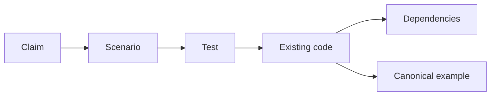

# Specification Driven Development

<div v-click class="sdd-subtitle">
  The spec is the prompt. Who checks the spec?
</div>

<!--
Timing: 0.5 minutes. The specification returns: 6 minutes total, slides 1–6.

I like talking about my failures. They’re a surprisingly reliable source of conference material.

Pause, then turn toward the lesson:

This is a talk about something awesome I learned the hard way: how badly SDD can go when you aren’t watching the process.

The spec is the prompt. But who checks the spec? My answer involved a review nightmare and burning a week's worth of tokens. My precious tokens. And the request that became Specht.

Keep the published promise in view: explicit specifications guide agents, and tests, lessons, and skills keep the workflow honest. The new question is how we check the reference the agents rely on.
-->

---
layout: two-cols
layoutClass: gap-16
class: agenda
transition: slide-up
---

# Agenda

::right::

<v-clicks>

- **The spec returns** — same discipline, new reader
- **The agent workflow** — what it reads and hands off
- **My precious tokens** — when author and reviewer drift
- **Check the drift** — deterministic tools in the loop
- **Own the process** — monitor evidence, keep humans accountable

</v-clicks>

<!--
Timing: 0.5 minutes.

We will keep the history brief, follow one checkout claim through the agent workflow, and use my experience as the turning point. The longest worked section shows how a deterministic check interrupts a mechanical failure. We finish with monitoring, human responsibilities, and how to build checks for your own process. Reserve the last three minutes for questions.
-->

---
transition: fade-out
class: illustrated
---

# In the Before Times

<div style="margin: 0.75rem 0 0.5rem;">
  
</div>

<div style="display: grid; grid-template-columns: repeat(4, minmax(0, 1fr)); gap: 1rem; text-align: center;">
  <div>
    <div style="color: var(--sdd-copper); font-weight: 700;">Paper</div>
    <div style="font-size: 18px; color: var(--sdd-muted);">Think it through. Write it down.</div>
  </div>
  <div>
    <div style="color: var(--sdd-copper); font-weight: 700;">Punch cards</div>
    <div style="font-size: 18px; color: var(--sdd-muted);">Make every card count.</div>
  </div>
  <div>
    <div style="color: var(--sdd-copper); font-weight: 700;">The '90s spec</div>
    <div style="font-size: 18px; color: var(--sdd-muted);">The whole system. In a binder.</div>
  </div>
  <div>
    <div style="color: var(--sdd-copper); font-weight: 700;">The Agile era</div>
    <div style="font-size: 18px; color: var(--sdd-muted);">The binder becomes a backlog.</div>
  </div>
</div>

<div style="margin-top: 1.25rem; text-align: center; font-style: italic;">
  Somewhere along the way, we lost the whole picture.
</div>

<!--

Timing: 1 minute.

A deliberately compressed, satirical history of the artifacts around development, not four mutually exclusive eras. Paper coding sheets and punched cards were often parts of the same workflow. Formal specifications predate the 1990s; that is the era this talk is recalling.

Start with the developer: when running the program was expensive, you thought it through on paper. Then you encoded it on cards. By the '90s, the specification binder promised a complete account of what the system should do. Requirements, constraints, traceability, sign-off. Behold the binder.

Then comes the shredder. This is the joke about what happened in some shops: the binder disappeared, the tickets survived, and the whole-system intent got scattered. Agile itself did not demand the destruction of specifications. The 2001 manifesto values working software over comprehensive documentation and explicitly retains value in documentation.

Source: https://agilemanifesto.org/

Bridge: before we bring the spec back as an agent's input, let's open that old binder and see what was actually useful. Next slide: A Spec, 1998.

-->

---
transition: fade-out
class: archive
---

# A Spec, 1998

```text
3.2.4  Discount Application

REQ-3.2.4.1  The system SHALL apply a valid discount code to the
             order subtotal prior to payment authorization.
REQ-3.2.4.2  The system SHALL reject a discount code whose expiry
             date precedes the current date and SHALL display
             message MSG-017 ("This code has expired").
REQ-3.2.4.3  The system SHALL NOT apply more than one discount
             code per order.
REQ-3.2.4.4  Orders with a subtotal of $75.00 or greater SHALL
             receive standard shipping at no charge.

Source:       BR-12 (Q3 Promotions)
Verified by:  TC-3.2.4.1, TC-3.2.4.2, TC-3.2.4.3, TC-3.2.4.4
Out of scope: Stacking, gift cards, loyalty points (see 3.2.7)
```

<!--

Timing: 1 minute.

This is an illustrative 1990s-style Functional Requirements Specification. The numbered claims, SHALL language, upstream source, and downstream test references are the useful parts. It is a fictional checkout example, not a historical document or a claim of compliance with a particular standard.

Read REQ-3.2.4.2 out loud. That is a test. Written by someone who never wrote a test.

-->

---
transition: fade-out
---

# What It Had, Why It Drifted

<div grid="~ cols-2 gap-8" m="t-2">
<div>

**Had**

- One ID per claim
- `SHALL` / `SHALL NOT` — no "should probably"
- Traceability both directions: BR ↔ REQ ↔ TC
- Explicit **out of scope**

</div>
<div>

**Maintenance cost**

- People reconciled documents and code
- Stale requirements could survive reviews
- Intent became scattered across tickets

</div>
</div>

<v-click>

<div m="t-6">

Now agents can help maintain it. Their edits need verification too.

</div>

</v-click>

<!--

Timing: 1 minute.

The document could go stale because keeping it aligned was expensive. Agents can help with that work, but their edits are not self-verifying. A machine reader can ask questions when instructed; it can also proceed confidently from the wrong interpretation. Do not assume it has understood or preserved the intent.

Keep the distinction from the history slide: Agile values working software over comprehensive documentation; it does not demand that teams discard specifications. The failure is letting an unchecked document outrank reality. Our new failure will be letting an unchecked agent edit redefine that document.

Source: https://agilemanifesto.org/

-->

---
transition: fade-out
class: illustrated
---

# The Spec Is Back

<div style="margin: 0.75rem 0 0.5rem;">
  
</div>

<div style="display: grid; grid-template-columns: repeat(3, minmax(0, 1fr)); gap: 1rem; text-align: center;">
  <div>
    <div style="color: var(--sdd-copper); font-weight: 700;">Old busted</div>
    <div style="font-size: 20px; font-weight: 600;">The specification</div>
    <div style="font-size: 18px; color: var(--sdd-muted);">Write it. File it. Forget it.</div>
  </div>
  <div>
    <div style="color: var(--sdd-copper); font-weight: 700;">New hotness</div>
    <div style="font-size: 20px; font-weight: 600;">AI chat</div>
    <div style="font-size: 18px; color: var(--sdd-muted);">Prompt it. Patch it. Repeat.</div>
  </div>
  <div>
    <div style="color: var(--sdd-copper); font-weight: 700;">Old busted hotness</div>
    <div style="font-size: 20px; font-weight: 600;">The spec drives the agent</div>
    <div style="font-size: 18px; color: var(--sdd-muted);">Specify it. Test it. Regenerate.</div>
  </div>
</div>

<div style="margin-top: 1rem; text-align: center; font-style: italic;">
  Same discipline. AI connects the claims and evidence.
</div>

<!--

Timing: 2 minutes.

Verbal riff on the Men in Black old-gear/new-gear joke, illustrated with ordinary developers in clothes appropriate to their era and age. The third label is the talk's punchline: "old busted hotness."

Old busted: the specification we just opened. Useful structure, but maintaining it by hand was expensive. The dusty binder is the failure mode, not the goal.

New hotness: ask AI for code. It feels like a superpower. But when intent lives only in a chat, you keep steering, patching, and repeating yourself. The middle panel satirizes that prompt-first workflow, not every use of AI chat.

Old busted hotness: the spec comes back as a versioned artifact the agent actually consumes. Numbered claims, acceptance criteria, constraints, and out of scope. Scenarios and tests check the implementation against those claims. Update the spec, review the delta, and run the workflow again.

AI makes it practical to draft, connect, and revise specifications, claims, scenarios, and verification artifacts together. That is the opportunity: keep the claims and the evidence close as the system changes. The model proposing those artifacts cannot be our only verifier. The comeback is explicit intent that agents consume in a versioned workflow. Humans decide what the system should do and review changes to that intent. Tests, lessons, skills, and deterministic checks support the handoffs; none makes an agent infallible.

Pause on the third label, then land: same discipline, new reader. Next slide puts TDD, BDD, and SDD on that continuum.

-->

---
transition: fade-out
---

# TDD, BDD, SDD

<v-clicks>

- **Test Driven Development** — failing test, implementation, refactor
- **Behavior Driven Development** — agreed behavior, scenarios, executable checks
- **Specification Driven Development** — explicit intent guides the agent's work

</v-clicks>

<v-click>

**SDD still needs BDD to agree on behavior and TDD to verify it.**

</v-click>

<!--
Timing: 1 minute. How agents use the spec: 8 minutes total, slides 7–10.

Keep this connection from the original talk. SDD belongs alongside disciplines the audience already knows. BDD turns claims into examples people agree on. TDD drives implementation through red, green, refactor. SDD supplies the versioned intent that connects them. Use all three together; a generated spec does not replace either discipline. We still need good tests and shared understanding. Writing intent upstream gives the agent a durable input, but does not make everything downstream automatic or correct.

The important change is where the next task starts: from agreed behavior and constraints rather than a fresh explanation in every chat. Tests, design choices, and code still require judgment. Next, follow one requirement through those handoffs.
-->

---
transition: slide-up
---

# Meet the Actors and Artifacts

<div grid="~ cols-2 gap-8" m="t-2">
<div>

**Who acts**

- **Human:** owns intent and acceptance
- **AI agent:** a model with instructions and tools; proposes and makes edits
- **Programs:** test runners execute checks; validators enforce explicit rules

</div>
<div>

**What they work on**

- **Feature:** a scoped capability, such as applying discount codes
- **Specification:** the versioned agreement on behavior, constraints, and scope
- **Claim:** one numbered, testable requirement in that agreement

</div>
</div>

People decide. Agents do work. Artifacts record the agreement and evidence.

<!--
Timing: 2.5 minutes.

Give the audience this vocabulary before showing agent handoffs. These are different kinds of participants: people and agents take actions; specifications and features are the subject of the work; deterministic programs supply particular checks. Do not imply that a document has agency or that a model owns the product decision.

Human means the people responsible for product intent, design, testing, and acceptance. One person may hold several responsibilities. AI means the model; an agent puts that model in a workflow with instructions, context, and tools so it can act. An agent can draft a spec, edit code, or review a diff, but the human remains accountable for approving meaning and accepting the result.

Feature here means a bounded product capability, such as applying discount codes. Its spec is the versioned agreement covering that capability: why it exists, testable claims, constraints, and exclusions. A claim is one acceptance criterion with a stable ID, such as AC-002. The implementation is the code that delivers the behavior; the spec describes what that behavior should be.

A test runner executes test code and reports what its assertions observed. A structural checker such as the tool introduced later compares artifacts with explicit rules. Neither is a product owner. A passing structural check and a passing behavioral test answer different questions.

Next assign the agent jobs, then use the checkout example to explain Gherkin, scenarios, and how their words become executable checks. Later, the file-layout slide shows where these artifacts live in this repository convention.
-->

---
level: 2
---

# Roles as Agents

| Role        | Reads                                  | Produces                    |
| ----------- | -------------------------------------- | --------------------------- |
| Spec author | Human intent, current spec             | Proposed spec delta         |
| Test writer | Approved claims, constraints           | Scenarios and failing tests |
| Implementer | Spec, tests, existing code             | Scoped implementation       |
| Reviewer    | Approved baseline, all diffs, evidence | Findings tied to claims     |

<v-click>

Instructions define the handoff. Tools check its explicit rules.

</v-click>

<!--
Timing: 1.5 minutes.

The actors now have jobs. Spec author, test writer, implementer, and reviewer are responsibilities assigned to an agent through its instructions and tools. The table describes a workflow contract, not a requirement for four separate sessions. You can use fewer agents and still preserve the responsibilities.

Notice that the spec author may be an agent too. I still own the intent. The author proposes changes; it does not get authority to redefine the requirement silently. The reviewer needs the approved baseline as well as the new spec. Otherwise, what prevents both roles from agreeing on a new requirement I never asked for?

For now, this looks reasonable. We have roles, files, tests, and a review. We have all the ingredients for a responsible workflow. That is what made the failure so frustrating.
-->

---
layout: two-cols
layoutClass: gap-8
class: claim-example
---

# One Claim Through the Loop

**Feature:** discount-code validation.

**Claim `AC-002`**

Reject an expired discount code and show an expired-code message.

**Constraint:** rejection happens before payment.

**Out of scope:** stacking discount codes.

::right::

**Gherkin:** a language for behavior examples.

```gherkin
Feature: Discount codes

  @AC-002
  Scenario: Reject an expired code
    Given a cart worth $50
    And SAVE10 expired yesterday
    When SAVE10 is applied
    Then the total remains $50
    And an expired-code message appears
```

A **scenario** is one example. **Bindings + a runner** execute its steps and assertions.

<!--
Timing: 3 minutes.

Explain the example using the vocabulary just introduced. The feature is the capability; the spec is its agreement; AC-002 is one claim in it. Gherkin is the structured language used in the .feature file. Feature: groups related scenarios; Scenario: names one concrete example; Given sets the starting state, When describes the action, and Then describes the expected result. And adds another step of the same kind.

A .feature file contains Gherkin, not application code. Step definitions (also called bindings) connect the step text to executable code. Then bindings perform assertions against observed behavior when the test runner executes them. For example, asserting both a $50 total and the expired-code message checks the two outcomes of AC-002. Writing the scenario or adding a claim tag alone does not run a test.

This is the condensed spec anatomy and Gherkin example. The business goal is clear checkout pricing. The user needs feedback when a code cannot be used. The claim is falsifiable, the constraint sets a boundary, and out of scope limits what the agent should add. We are keeping the checkout example from the existing talk.

For the modern examples, AC-002 is our short claim identifier for the expired-code requirement previously shown as REQ-3.2.4.2. This is an explicit presentation mapping, not an instruction to renumber real requirements. The @AC-002 tag carries that identity into the scenario; it is a reference, not an assertion. Traceability records the links from the claim to its scenarios and tests. The test needs assertions for both the unchanged total and the message. A descriptive test name alone proves neither.

Ask the audience to consider what happens if the tag disappears, then what happens if the author changes 'reject' to 'accept.' Those are different failures. One concerns the relationship; the other concerns the intent. We now have the people, agent jobs, agreement, examples, executable checks, and implementation in view. Next comes the story of trusting this loop too far.

Terminology source: https://cucumber.io/docs/gherkin/reference/ (Feature, Scenario, Given/When/Then, step definitions, and assertions).
-->

---
layout: center
class: text-center
transition: fade
---

# My Precious Tokens

<div style="margin-top: 2rem; font-size: 1.8rem; line-height: 1.5; color: var(--sdd-copper);">
  “I burned a week's worth of Claude Max tokens<br/>trying to review a pull request.”
</div>

<div style="margin-top: 1.5rem; color: var(--sdd-muted);">A real review loop in one of my projects</div>

<!--
Timing: 1 minute. The token horror story: 10 minutes total, slides 11–16.

This is my account of what happened. The quote describes my experience with the review cycle, not a benchmark of Claude or a measured comparison between tools. The review counts later in the story come from my account, including work away from GitHub. Do not infer them from GitHub event counts or invent a dollar amount.

As always, this is a story from the trenches.  This is a real story, all tokens discussed in it were burned frivolously and it was not completely the fault of the provider.

I had the spec. I had an author. I had a reviewer. And I was burning those tokens on the process that was supposed to keep the work honest. This is the horror story promised in the opening.
-->

---
transition: slide-up
class: artifacts
---

# The Files Behind the Workflow

In this workflow, each feature keeps a **`.spec/` folder beside its code**.

| Artifact     | What the agent learns                                       |
| ------------ | ----------------------------------------------------------- |
| `README.md`  | Claims, constraints, scope, and traceability                |
| `*.feature`  | Concrete behavior scenarios linked to claims                |
| `adr/`       | Architecture Decision Records: the technical choice and why |
| `decisions/` | Product and scope choices, including rejected options       |
| `lessons/`   | What failed, why, and what changed in the spec or procedure |

**`.specht/` is separate:** checker configuration, schemas, and starter templates.

These are the artifacts the author and reviewer were trying to keep aligned.

<!--
Timing: 1.5 minutes.

To explain the review nightmare, first show the artifacts the author and reviewer were trying to reconcile. These are two different folder names: dot-spec contains the specification and its supporting records; dot-specht contains the tool's configuration, schemas, and templates. Neither is a .NET SDK installation folder. A .NET tool is the packaging mechanism for the checker.

A feature's .spec/README.md is its agreement: numbered claims, constraints, out of scope, design, traceability, and sign-off. Its companion .feature file contains the Gherkin scenarios introduced earlier, with tags linking them to claims. The product feature is the capability; the .feature file is an artifact describing examples of its behavior. Those scenarios become executable checks when test bindings implement them and the runner executes them.

ADR means Architecture Decision Record. It keeps the context, alternatives, technical decision, and consequences so the next agent does not reopen a settled design as an unexplained gap. A product decision record instead preserves what we chose to build or exclude and why. A lesson records an observed failure, root cause, and follow-through: a product lesson changes the relevant claim/scenario when needed; a process lesson changes the reusable procedure or skill. Agents must retrieve and apply the relevant records; their existence alone does not change model behavior.

These paths are relative to a feature's .spec/ folder. Records that apply across features belong in the repository-root .spec/adr/ or .spec/lessons/ instead. Scope determines where the record lives. This is an orientation, not a tour of every required heading.

.specht/manifest.json configures the checker and its schema selection; .specht/schema/ stores schemas; .specht/templates/ stores starter documents supplied by init --all. Templates are blanks to fill and place with the relevant feature, not finished specifications. Installing Specht does not author the requirements, bind scenarios, run behavioral tests, or configure agent handoffs for us. The base checker validates selected rules on specifications and their relationships; it does not read adr/, decisions/, or lessons/ to establish their truth.

Sources: https://github.com/RLittlesII/specht/blob/main/docs/setup.md ; https://github.com/RLittlesII/specht/blob/main/docs/what-it-checks.md ; https://github.com/RLittlesII/specht/tree/main/.specht/templates
-->

---
transition: slide-up
---

# What Is a Claim?

A **numbered, testable acceptance criterion**: what the system must do.

**Example phrasing — the intended replay behavior**

```text
AC-011: If the store is busy or unreadable, report an
       environment failure and exit with category 3.
```

- **ID:** `AC-011` gives that agreement a stable reference
- **Scenario:** a concrete example that exercises the claim
- **Traceability:** the links from the claim to its scenarios and tests

The ID names the agreement. It does not prove the wording is right.

<!--
Timing: 1.5 minutes.

AC stands for acceptance criterion. For consistent presentation, the audience-facing deck uses AC- identifiers; the source repository uses B-. Thus B-011 is displayed as AC-011, and B-003 as AC-003. This is a presentation mapping, not a recommendation to renumber existing repository IDs. Original identifiers remain in pr-evidence.md and the source-specific notes.

A claim is an individual requirement we can challenge with evidence, not a vague aspiration such as 'replay should work well.' Its identifier lets authors, scenarios, tests, and reviewers refer to the same agreement. IDs are stable within their feature; a full reference includes the feature when we cross its boundary. B-011 in one feature need not mean B-011 in another.

The displayed wording is a simplified explanation of the intended behavior, not a verbatim historical excerpt. The actual replay case distinguishes an environment failure, category 3, from a rejected request, category 1. We need only that distinction to understand the next slide. We are not teaching the entire replay design.

A scenario gives a concrete input and expected result. A traceability row records which scenarios and tests relate to the claim. An existing row is not proof that its test runs, passes, or asserts the right thing. Likewise, a valid ID cannot make incorrect wording true.

Bridge from the checkout example to the incident: the mechanism is the same, but the real repository was handling replay failures. Set up the drift: what happens if the claim says category 1 while the design says category 3, and a downstream test author copies the claim? That is the actual incident on the next slide. Keep the reference stable, review changes to meaning, and check the relationships mechanically where possible.

Source provenance for the actual exit-category contradiction: pr-evidence.md, 'A wrong claim propagated into a scaffold.' This slide's short requirement sentence is explanatory phrasing.
-->

---
transition: fade-out
---

# The Spec Started Drifting

**Actual review evidence: a replay command**

| Same failure: store busy or unreadable | Exit category |
| -------------------------------------- | ------------- |
| Revised claim `AC-011`                 | **1**         |
| Design § 7, `R3` / `R13`               | **3**         |
| Test stub's expected result            | **1**         |

```cs
// Then a structured failure is reported and the exit code is category 1
```

The incorrect claim propagated into the test scaffold.


<!--
Timing: 2 minutes.

This is actual PR evidence from a private project. The project was changing its replay write path to an append-only request consumed later by the daemon. The domain detail we need: a busy or unreadable store is an environment failure, which the design maps to exit category 3.

At reviewed commit fdbae932c81169920f2e3d2eba0f8b2f676e838f, feature 0005-F5b's revised B-011 included store/config preconditions and busy-timeout in category 1. The same spec's § 7 R3/R13, domain row, and diagrams mapped StoreBusy/StoreUnreadable to category 3. The staged test copied the category-1 expectation. The line on screen is verbatim from ReplayCommandHandler.Unit.Tests.cs:153 at that commit. This was a scaffold: its body called Assert.Fail("not implemented — scaffold only"). Do not describe it as a passing executable test or a shipped production bug.

The review explicitly identified that the stub inherited the wrong reading. It caught this contradiction; the evidence does not show that every reviewer blindly accepted the spec. My account supplies the broader author/reviewer cycle and token cost. GitHub supplies concrete contradictory artifacts and remediation history.

Source provenance: see pr-evidence.md for the reviewed artifacts, original PR identifiers, and pinned source links.
-->

---
transition: slide-up
---

# The References Drifted Too

**Actual review evidence: the original and follow-up PRs**

- **Original PR:** five accepted claims, zero traceability rows
- **Follow-up PR:** scenario tagged `@AC-011`; the spec says `AC-003` governs it
- **Follow-up PR:** the scenario appeared under neither claim in § 9

**The verified correction — IDs shown as `AC-`**

```diff
-    @AC-011
+    @AC-003
```

The correction also added the scenario to `AC-003`'s traceability row.


<!--
Timing: 2 minutes.

These are separate findings across the two PRs, not one invented diff. In #214, the review of 0001-F4 found five accepted claims B-001–B-005 with no § 9 rows. The document argued that rows would wait for scenarios, but the contract required one row per claim even when its test was marked Missing. An explicit gap and an absent row are different states.

In #215, the replayed-secret-failure scenario had already been rewritten to describe a later listing of an attempt's failure. Its tag still said B-011. The spec's own B-011 text now assigned that behavior to B-003, yet neither claim's § 9 entry listed the scenario. Both IDs existed. Merely checking whether a tag resolves would not catch assignment to the wrong claim; the human semantic finding determines the intended assignment.

At reviewed commit 4e95b5b7bdddeab266f8d0f7631b0a13307ca76d, the feature tag was @B-011 at line 110, and the two matrix rows omitted the scenario. Correction commit 90ab1fed669bcae50b5bafad159bc59583a2f1cd retagged it @B-003, added the scenario title to B-003's row, and reconciled related citations. The diff on screen preserves the actual tag correction, with B- prefixes displayed as AC- and the unchanged scenario title omitted for readability.

This shows the distinction needed for Specht: missing required rows can be checked mechanically. Determining which valid claim describes a scenario's meaning still needs review. Do not claim Specht automatically diagnoses the semantic misassignment just because it can validate references.

Source provenance: see pr-evidence.md for the reviewed artifacts, original PR identifiers, and pinned source links.
-->

---
layout: center
class: text-center
transition: fade
---

# Author. Reviewer. Repeat.

**My account of the review effort by the time it was done**

| Review effort            | Scale                              |
| ------------------------ | ---------------------------------- |
| Comments on the PR       | More than 200                      |
| Reviews away from GitHub | About half                         |
| AI reviews               | 20+                                |
| Rounds per AI review     | 10+; highest I recall: 18          |

<div style="margin-top: 1rem; font-size: 1.3rem; color: var(--sdd-copper);">Burning tokens like cash to keep warm.</div>

<v-click>

**Wait. I can build a thing to check these rules.**

</v-click>

<!--
Timing: 2 minutes.

The repair history is visible; the token bill and review-effort figures are my reported experience. By the time the PR was done, there were over 200 review comments on it. About half the reviews happened away from GitHub. There were 20+ AI reviews, each taking 10+ rounds; the highest I recall was 18 rounds. A review and a round within that review are different units. These figures were supplied for this talk on October 28, 2026; they are not counts reconstructed from GitHub events. PR #214 contains repeated review-remediation commits, including d25739a (review feedback), 0aa4962 (traceability rows), and d953cac (lesson-register integrity collapse). It was closed without merging. My closing comment called it “a reminder of what to do when AI goes rogue!” The full comment is preserved in pr-evidence.md.

PR #215 continued with spec, feature-file, and scaffold changes, received further change requests, and ultimately merged on October 7, 2026. This was not an endless unresolved PR: show the eventual outcome as well as the failure. Do not equate the number of GitHub review events, replies, or commit messages with a verified count of internal model-review rounds. The retained history includes rewritten/squashed material.

Land the cost metaphor: I was burning tokens like cash to keep warm. The review loop kept running, but we kept paying to rediscover rules we already knew. Pause before advancing the reveal.

Reveal the eureka moment: “Wait. I can build a thing to check these rules.” Let the audience sit with that change in direction: from paying for another review to engineering a check for a recurring failure. I could build something to address the mechanical part of the problem that was burning my tokens. This does not mean a checker could settle every semantic disagreement or guarantee savings.

The follow-up eventually merged, but getting to a merge had exposed a process problem. I needed to fix the repository workflow that had produced this loop. Once I realized I could make those rules executable, the next step was the schema-like validation request on the following slide.

Source provenance: see pr-evidence.md for the reviewed artifacts, original PR identifiers, and pinned source links.
-->

---
transition: slide-up
clicks: 4
---

# SDD Inception

```mermaid {key: $clicks, scale: 0.75, themeCSS: ['.sdd-step-1', '.sdd-step-2, .flowchart-link[data-id=edgeAB]', '.sdd-step-3, .flowchart-link[data-id=edgeBC]', '.sdd-step-4, .flowchart-link[data-id=edgeCD]'].map((selector, index) => selector + ' { visibility: ' + ($clicks > index ? 'visible' : 'hidden') + '; }').join(' ')}
graph LR
accTitle: How Specht grew out of SDD
accDescr: Using SDD to build software exposed drift in the process. SDD then guided the development of Specht, which checks SDD artifacts.
A["Use SDD<br/>to build software"] edgeAB@--> B["Discover drift<br/>in the SDD process"]
B edgeBC@--> C["Use SDD<br/>to build Specht"]
C edgeCD@--> D["Use Specht<br/>to check SDD artifacts"]
class A sdd-step-1
class B sdd-step-2
class C sdd-step-3
class D sdd-step-4
```

<v-clicks :at="2">

- Fix the repository where the drift happened
- My request: **“Think of the spec like a JSON Schema.”**
- **And Specht was born.**

</v-clicks>

<!--
Timing: 1.5 minutes. Building a way out: 11 minutes total, slides 17–22.

Reveal the diagram from left to right on four clicks. Click 1: using SDD to build software. Click 2: discovering drift, together with the repository-fix bullet. Click 3: building the checker, together with the JSON Schema request. Click 4: applying it to SDD artifacts, together with “And Specht was born.” Each incoming arrow appears with its destination. The diagram keeps its full layout throughout.

This is SDD Inception: I used specification-driven development, discovered drift in the process, and asked for a fix in the affected repository. My instruction was to think of the spec like a JSON Schema. That request gave rise to Specht; SDD then guided development of the tool for specification-driven development. The origin was a concrete repository problem.

The analogy is a checkable contract: required structure, identities, and relationships with reproducible diagnostics. It does not mean every Markdown claim is literally JSON Schema, or that schema validation proves the business meaning of a requirement. Let that nesting be the joke. The point is the method being applied to improve the method itself.

The need was concrete: preserve the structural contract so agents could proceed with useful evidence. Specify the checks, test valid and broken inputs, build the checker, and apply it to the artifacts in the workflow. The diagram expresses that relationship, not a claim that the PRs contain every step of Specht's implementation history.

Build tools like Specht to improve your own AI specification-driven process. A focused script that checks one recurring failure is a useful start. Specify the invariant, write failing examples and valid controls, implement it, then put the result in the handoff. This is BDD and TDD applied to the SDD tooling itself.

The checker is software too. Its rules can be wrong or incomplete, so those rules need review and tests. Moving a check out of an LLM gives us a reproducible verdict for that rule; it does not make the rule infallible. Next, meet the tool that grew from that request, then follow one check through a repair.

-->

---
transition: slide-up
---

# Meet Specht


<div style="max-width: 530px;">

A .NET tool that checks your feature specifications and their relationships.

<v-clicks>

- IDs and references
- Required traceability relationships
- Schema and section structure
- Dependency consistency

</v-clicks>

<div style="margin-top: 1.5rem; color: var(--sdd-copper);">Same inputs and pinned rules. Repeatable findings.</div>

[github.com/RLittlesII/specht](https://github.com/RLittlesII/specht)

</div>

<!--
Timing: 1.5 minutes.

That request became Specht. Its job is to make the specification contract mechanically checkable. It checks explicit rules against the spec tree and reports violations. The checker runs offline; pinning the tool and schema versions keeps the rule set reproducible across machines and CI.

Keep the description narrow. It does not understand whether accepting expired codes serves the business. It can check whether claims have the expected IDs and traceability relationships, whether feature tags resolve, and whether declared dependencies agree.

The callback: my precious tokens should go toward reasoning that needs a model, while a deterministic checker handles the rules it can enforce. This is a design choice about the workflow, not a measured claim about savings. Return to the checkout claim from the opening: we can demonstrate the same missing-row failure without teaching the entire private replay system.

Source: https://github.com/RLittlesII/specht (README: checker, pinned schema, supported checks).
Logo: existing dark-background SVG from Specht's .assets/logos/specht-book-logo-dark.svg, reused unchanged.
-->

---
transition: fade-out
---

# A Claim Loses Its Traceability Row

**Checkout example — canonical table shapes, abbreviated cells**

```markdown
## 3. Acceptance Criteria

| ID     | Claim                 | Source | Status |
| ------ | --------------------- | ------ | ------ |
| AC-002 | Reject expired codes. | need 1 | Active |
```

```diff
 ## 9. Traceability Matrix

 | Claim ID | Scenario     | Test              | Status  |
 | -------- | ------------ | ----------------- | ------- |
- | AC-002   | Expired code | RejectExpiredCode | Covered |
```

**Drift:** the claim remains; its declared verification link disappears.

<!--
Timing: 2 minutes.

This is an illustrative checkout reconstruction, using the actual default template's section headings and table columns. Cells are shortened to fit. AC-002 still means rejecting the code and displaying the expired-code message, before payment. The full claim and scenario were introduced earlier.

Use an AC-prefixed identifier grammar in the manifest for these teaching examples; Specht's default grammar uses B-. These are excerpts, not a complete runnable specification. Assume the remaining document and companion are valid.

This mirrors the original incident's five accepted claims with no traceability rows. SPEC031 compares the claim IDs in the first cells of the claims and matrix tables, requiring exactly one matrix row per claim. A Missing test is an explicit gap; deleting the whole row loses that information. No model needs to reason about whether the row is present.

Sources: Specht .specht/templates/feature.md and docs/rules/v0.2.1/SPEC031.md in the local source checkout; public rule reference: https://github.com/RLittlesII/specht/blob/main/docs/rules/v0.2.1/SPEC031.md
-->

---
transition: fade-out
---

# A Diagnostic the Agent Can Act On

```sh
dotnet specht
```

**Expected finding for the missing `AC-002` row**

```text
error SPEC031 [AC-002]
claim 'AC-002' has no row in § 9 - every § 3 claim
appears there exactly once, with 'Missing' as its
test until one exists
```

<v-click>

File + line + rule + claim → a bounded repair before the next handoff.

</v-click>

<!--
Timing: 2 minutes.

The message follows the canonical SPEC031 rule reference for schema 0.2.1, with AC-002 substituted consistently for our checkout example. Line wrapping and the separate rule/identifier heading are presentation formatting. This is expected diagnostic content, not captured CLI output. Actual reports include the file and line at the claim's row in section 3; no invented line number is shown.

Point out the stable claim reference: the failure and repair concern the same AC-002 we followed from the scenario. Keep the claim identity consistent from the scenario through the failure and repair.

The orchestrator or CI must honor failure. Printing a diagnostic alone does not stop another agent continuing. Give the author the finding and the approved baseline, then require a new check result for the repaired revision.

Source: https://github.com/RLittlesII/specht/blob/main/docs/rules/v0.2.1/SPEC031.md (checked against the local rule reference).
-->

---
transition: fade-out
---

# Restore the Relationship

**Preserve the claim. Record the evidence you actually have.**

```diff
 ## 9. Traceability Matrix

 | Claim ID | Scenario     | Test              | Status  |
 | -------- | ------------ | ----------------- | ------- |
+ | AC-002   | Expired code | RejectExpiredCode | Covered |
```

<v-clicks>

- BDD: agree on the unchanged total and expired-code message
- TDD: see the assertions fail, implement, pass, then refactor
- Validate the links again; review the spec and test diffs

</v-clicks>

<!--
Timing: 2 minutes.

The row uses the canonical matrix columns with shortened scenario/test labels. Restore Covered only after inspecting and executing the actual test, including both assertions and the before-payment constraint. A row is a declaration, not proof that the test exists or runs.

If the test does not exist yet, use Missing for Test and Status. SPEC031 accepts that explicit gap. SPEC060 separately reports Missing cells when spec_status is approved, with error severity by default; repository policy can change that severity. Do not fabricate a test name or remove the claim to make a check pass.

BDD still supplies shared examples. TDD still checks that the implementation makes the relevant failing tests pass and supports refactoring. Structural checks complement both. Humans review whether the examples and assertions preserve the approved behavior.

Source: https://github.com/RLittlesII/specht/blob/main/docs/rules/v0.2.1/SPEC031.md ; https://github.com/RLittlesII/specht/blob/main/docs/rules/v0.2.1/SPEC060.md
-->

---
transition: fade-out
---

# Which Drift Can a Program Catch?

| Edit                                    | Deterministic finding              |
| --------------------------------------- | ---------------------------------- |
| Delete `AC-002`'s matrix row            | `SPEC031`: claim has no row        |
| Tag a scenario `@AC-999`; no such claim | `SPEC021`: tag does not resolve    |
| Declare `AC-002` twice                  | `SPEC030`: duplicate claim ID      |
| Approve a matrix with `Missing` cells   | `SPEC060`: missing coverage marker |

<v-click>

**A valid but wrong tag? A contradictory claim? Review meaning.**

</v-click>

<!--
Timing: 2 minutes.

These are canonical rule cases, adapted to the AC-prefixed teaching convention. Each edit is independent, with otherwise valid artifacts and configured claim grammar. These are rule summaries, not captured terminal output. SPEC060 has default error severity; the repository can configure a different level.

Connect them directly to the incident: absent rows in the original PR map to SPEC031. An unknown tag would trigger SPEC021, but the actual follow-up used the wrong EXISTING ID. Both AC-011 and AC-003 resolved. Tag resolution alone cannot choose the intended claim. The category-1/category-3 contradiction likewise needs semantic review. Duplicate IDs and premature approval are additional failure cases to automate, not claims about what happened in those PRs.

A program can compare explicit relationships without a fresh model judgment on every run. Build a check when you can state the invariant. For meaning, involve the people who own the behavior, then encode the agreed cases in executable tests where possible.

Sources: Specht docs/rules/v0.2.1/SPEC030.md, SPEC031.md, SPEC021.md, and SPEC060.md in the local source checkout. Public references: https://github.com/RLittlesII/specht/tree/main/docs/rules/v0.2.1
-->

---
transition: slide-up
---

# A Passing Check Is Not Acceptance

| Evidence              | Establishes                        | Still needs judgment             |
| --------------------- | ---------------------------------- | -------------------------------- |
| Structural validation | Selected rules are satisfied       | Is the claim correct?            |
| Traceability          | Required relationships are present | Are the examples sufficient?     |
| Passing tests         | Executed assertions passed         | Do they test the right behavior? |
| Human review          | Intent and changes were examined   | What have we missed?             |

<v-click>

A well-formed instruction to accept expired codes is still the wrong instruction.

</v-click>

<!--
Timing: 1.5 minutes. Keeping the workflow focused: 10 minutes total, slides 23–30.

We have moved a repeated relationship check out of the model conversation. Now return to the process: who decides whether that relationship connects the right things? Return to AC-011 from the actual PR. It remained a valid claim identifier even while its exit-category wording contradicted the design. A structural checker cannot decide which category expresses the intended behavior. Likewise, AC-011 and AC-003 were both valid IDs in the follow-up PR; choosing the right one for the scenario required understanding its meaning.

The point is to use each kind of evidence for the question it can answer. Humans must compare spec changes with approved intent. Tests must exercise meaningful behavior. The deterministic checker enforces its selected rules, consistently, without claiming to establish the truth of the business requirement.

Human review has limits too. This is a layered workflow, not a final guarantee. It makes the questions and responsibilities visible so the next agent is not reasoning from an unexamined reference.
-->

---
transition: slide-up
---

# The Loop, With Gates

```mermaid {scale: 0.68, flowchart: {padding: 10, rankSpacing: 20, wrappingWidth: 140}}
graph LR
accTitle: The agent workflow with validation and review gates
accDescr: Human-approved intent guides agent edits. Failed validation returns to editing. Passing validation proceeds to scenarios, tests and code, then review. Review either approves completion or returns corrections to the agent.
H["Human-approved<br/>intent"] --> A["Agent edits"]
A --> V{"Validation"}
V -->|fail| A
V -->|pass| T["Scenarios<br/>tests + code"]
T --> R["Review changes<br/>+ evidence"]
R -->|approve| D[Done]
R -->|correction| A
```

- Validate before handoff; pause repeated failures for human diagnosis
- Run behavioral tests and retain their results
- Changes to intent return to human approval

<!--
Timing: 1.5 minutes.

The diagram compresses downstream authoring to keep it readable. Validation repeats as scenarios, tests, and code change; it is not a one-time check on the first draft. The workflow must actually branch on the result. A required validation failure stops the downstream handoff and returns actionable findings to the responsible edit.

Review findings should identify the relevant requirement, artifact, and evidence. If the implementation is wrong, fix the implementation. If the test is wrong, fix the test. If intent needs to change, review and approve the spec delta before propagating it. Do not automatically rewrite the spec to match whatever the code happens to do.

Repeated failures must not become an unbounded author/reviewer loop. Agree on a review budget or escalation trigger for the task. When a finding persists or reviews conflict, pause automated retries and give a named human the baseline, latest diff, findings, and attempted repairs. Diagnose the rule, context, or requirement before restarting.

This gate placement is the proposed SDD workflow for the talk, not a claim that installing Specht automatically configures agent orchestration or CI.
-->

---
level: 2
---

# Humans Own the Decisions

<v-clicks>

- **Product / domain owner:** approve claims, scope, and intent changes
- **Tester:** challenge examples, boundaries, and assertion quality
- **Developer:** own design, implementation, and the checks themselves
- **Reviewer:** compare baseline, diffs, and evidence before accepting

</v-clicks>

<v-click>

Agents propose and execute. Humans remain accountable for acceptance.

</v-click>

<!--
Timing: 1 minute.

These are human responsibilities even when agents perform much of the authoring and execution. One person may hold several roles; each decision still needs an owner. Product owns what should happen, testing challenges whether the examples and assertions expose failures, development owns the implementation and checking tools, and review decides whether the evidence supports acceptance.

The reviewer must see how the spec changed. A request to implement AC-002 does not authorize reversing it to make the implementation pass. Unresolved disagreements and repeated failed repairs return to a human instead of triggering another automatic review.

Review agents can reason about gaps and suggest improvements. Humans retain the decision about business intent, and ordinary code review still matters: satisfying a claim does not excuse unsafe or unmaintainable implementation. Structural reports provide evidence, leaving more attention for these substantive questions.
-->

---
level: 2
---

# The Tester Gets the Spec First

<v-clicks>

- Challenge acceptance criteria before implementation
- Add edge cases the current scenarios miss
- Check that test assertions express the claim
- Explore the running product; turn findings into reviewed regressions

</v-clicks>

<div style="margin-top: 1.5rem; color: var(--sdd-copper);">Traceability makes gaps visible. Testing judgment decides what fills them.</div>

<!--
Timing: 1 minute.

Preserve the tester's upstream role from the original deck. A missing row is useful evidence, but a row with an inadequate test can be just as important. Testers ask whether we covered the boundary, the failure path, and the interactions nobody thought to write down.

Exploration still matters. When it reveals a gap, determine whether the intended rule needs clarification or the implementation needs fixing, then add an appropriate regression. Scenarios become executable evidence when bound to tests and actually run; writing a scenario alone does not automate a regression pass.
-->

---
level: 2
---

# Make Lessons Change the Next Run

**The same incident exposed a gap in how the process learned**

- `L-0007`: review found no historical incident matching its example
- `L-0009`: a lesson about signature consistency misquoted the signatures


<v-clicks>

- **Lesson:** preserve evidence with the decision
- **Skill:** retrieve it, apply the procedure, run the checks
- **Handoff:** report current results; recording a lesson is not fixing it

</v-clicks>

<!--
Timing: 1.5 minutes.

Monitoring is useful only if findings change the next run. Apply that test to lessons from the same incident: even the learning artifacts needed verification. The L-0007 review reports git-history searches for 'Table C' and 'row 2 of' that found those strings only in the commit introducing the lesson, not the feature it described. It also points out that stable C-n constraint IDs had been mischaracterized as positional references. Attribute that history audit to the review; it is not a newly rerun search of all branches for this presentation.

L-0009, a lesson about keeping port signatures consistent, misquoted both signatures. A later reply states that d953cac recorded the finding in L-0012 while leaving L-0009 unchanged. Tracking a correction is not performing it. The lesson-register-collapse entry documents fabricated incidents, misquoted code, reversed facts, and lessons failing to guide the review process.

A useful lesson preserves its evidence. A skill gives the agent a reusable procedure: retrieve the relevant claims and lessons, verify citations against current artifacts, run applicable checks, and return current results. Merely writing a lesson does not make the next run learn it. A human owns verifying the lesson and changing the affected artifact or procedure. The next handoff must show that the change was applied. Factual and semantic lesson claims still need review; automate specific checks where possible rather than promising a general truth detector. Next, make that evidence useful to the agent taking over the work.

Source provenance: see pr-evidence.md for the reviewed artifacts, original PR identifiers, and pinned source links.
-->

---
level: 2
---

# Make Every Handoff Inspectable



<v-clicks>

- Link the claim to existing code and affected dependencies
- Attach the revision, diffs, check results, and test results
- Name unresolved gaps, their owner, and the next decision

</v-clicks>

<!--
Timing: 1 minute.

The next person or agent needs enough evidence to inspect the handoff without reconstructing the whole conversation. The spec says what should happen; code navigation reveals what already exists and which dependencies may be affected. Otherwise, the agent can implement the right behavior in a duplicate service or overlook a dependent caller.

Include the approved claim, current revision and diff, results from pinned checks and the test runner, and an owner for each unresolved gap. A useful handoff states what decision remains, not merely that the previous agent is done.

The graph here is a conceptual map, not a Specht feature or a mandate to install a graph database. A graph can help query relationships; symbol navigation and other repository tools can supply useful evidence too. Share paths, symbols, and actual results rather than unsupported design claims. The point is an inspectable handoff: another reviewer can follow the claim to the implementation and assess the attached evidence.
-->

---
transition: slide-up
---

# What You Gain, What You Maintain

<div grid="~ cols-2 gap-8" m="t-4">
<div>

**Potential gains**

- Less repeated steering
- Clearer agent context and scope
- More autonomous work between gates
- Failures recorded for future runs

</div>
<div>

**Continuing work**

- Review intent and spec changes
- Maintain rules, tests, and instructions
- Integrate checks into handoffs
- Investigate gaps a checker cannot see

</div>
</div>

<v-click>

Start with one feature and one recurring failure you can check.

</v-click>

<!--
Timing: 1 minute.

These are expected advantages of the workflow, not measured Specht outcomes. Clear inputs and checks can let an agent proceed farther within an agreed scope. They also introduce artifacts and rules that somebody must maintain.

Avoid turning this into a new binder ceremony. Start with a real feature and a failure that keeps recurring. Decide what evidence would expose it, automate the deterministic part, and retain the human decision where meaning matters. Expand when the checks are useful.

We have gone from the review nightmare to one deterministic check, then back to the people and evidence that keep the process working. Start at that scale. Next, apply it to a codebase that already exists, without stopping delivery for a documentation rewrite.
-->

---
transition: slide-up
---

# SDD in a Brownfield Codebase

I'm using this on a large existing project today.

<v-clicks>

- Start with the requirements already written down
- When you fix a bug or touch an area, clarify its intended behavior
- Add acceptance criteria, scenarios, and checks for that change
- Fill gaps as the work reaches them; record what you learn

</v-clicks>

<div style="margin-top: 1.5rem; color: var(--sdd-copper); font-size: 1.2rem;">You do not need to backfill the whole system before you start.</div>

<!--
Timing: 1.5 minutes.

Head off the greenfield question directly. Does this work in brownfield? Not as smoothly as starting with a clean slate, but you do not need a greenfield project to get value. I am using it on a large existing project right now. The information is at least written down and we have requirements, so there is something to start from.

We are not stopping delivery to reverse-engineer and specify every feature. When we encounter a problem, fix a bug, or change an area of code, we use that work to clarify the local requirements, add acceptance criteria and scenarios, and introduce relevant checks. We backfill as we go. Areas we have not touched do not need to be documented before the first area can benefit.

Use existing requirements, tests, and code as evidence. Do not assume current behavior is automatically intended behavior: an existing bug should not become a requirement merely because an agent observed it. Resolve that question with the people who own the behavior, then record the agreement and the regression evidence for the change.

The first changed area gives us a small process to monitor: are its claims stable, are tests current, and do recurring findings get resolved? Be candid about the limitation. This produces partial coverage, and existing code carries context and dependencies the documents may not yet capture. A passing check for the area we specified does not certify the entire legacy system. It still gives the next person or agent a better starting point in that area.

Source: Rodney's account of current use on a large existing project, supplied for this talk. No project identity, size metric, adoption rate, or measured benefit is claimed.
-->

---
transition: slide-up
---

# Monitor the SDD Process

| Watch at each handoff               | Human response                       |
| ----------------------------------- | ------------------------------------ |
| Claims changed or withdrawn         | Compare with approved intent         |
| Broken links or missing coverage    | Assign an owner; require repair      |
| Failed, skipped, or stale test runs | Re-run on the current revision       |
| Repeated findings or review loops   | Pause; assign a human to diagnose    |

Keep the revision, check results, test results, and unresolved gaps together.

<!--
Timing: 1 minute. Closing and questions: 5 minutes total, slides 31–33.

Monitor the process by retaining evidence per revision and per scoped handoff. A green result from yesterday or from a different diff is not evidence for this change. Record what was checked, with which tool/schema versions, what failed or was skipped, and who owns unresolved gaps. Required failures block handoff; exceptions need a named human decision and rationale.

Look for patterns: are the same links repeatedly repaired, are tests disappearing, are agents changing requirements to obtain green results, or are author/reviewer rounds repeating the same finding? When review rounds stop producing progress, pause the loop and diagnose it with the responsible human. Then improve the rule, tool, context, or instruction before resuming. This is the intervention missing from the token nightmare. Counts help identify friction; a green dashboard does not establish correct intent.

This monitoring is the team's workflow responsibility. It is not a claim that Specht supplies a monitoring dashboard or detects stale test evidence through its base structural rules. Test runners and CI supply execution evidence; people review its relevance and gaps.
-->

---
transition: slide-up
---

# Build Tools for Your SDD Process

AI helps connect **the spec, its claims, and their verification**.

<v-clicks>

- Pick a recurring failure and specify a checkable invariant
- Use BDD examples and TDD to build a small deterministic check
- Give agents actionable findings; enforce the gate in CI
- Keep humans responsible for intent, evidence, and acceptance

</v-clicks>

<div style="margin-top: 1.25rem; color: var(--sdd-copper);">Make the process verifiable. Give your precious tokens a better job.</div>

<!--
Timing: 1 minute.

AI's contribution is helping us author, connect, and maintain explicit claims and the artifacts that verify them at the pace of change. Verification cannot rest on the same model saying its work is correct. Use deterministic checks wherever the agreement can be expressed as a rule or executable assertion. Use human judgment to choose the agreement and examine what the checks miss.

Build tools like Specht for your own SDD process: start with one recurring finding, specify valid and invalid examples, develop the check with red/green/refactor, pin its rules, and make its result part of the handoff. BDD aligns what the rule means; TDD checks its implementation. Neither becomes obsolete because an agent writes the files.

Specht is one example of that engineering response. The takeaway is a process people can inspect and improve: humans own intent and acceptance, agents do bounded work, programs check explicit rules, and tests exercise behavior. Give your precious tokens a better job.
-->

---
layout: center
class: text-center
transition: fade-out
---

# Questions

<div style="margin-top: 1.5rem; color: var(--sdd-copper); font-size: 1.2rem;">
  Which recurring review finding could a program check in your workflow?
</div>

<div style="margin-top: 2rem;">

**What would you check, what evidence would you keep, and who would act?**

</div>

<!--
Timing: 3 minutes. End at 50 minutes including questions.

Thank the audience. Use the prompt if questions need a starting point: a missing ID, broken relationship, stale reference, or dependency mismatch from their own process. Distinguish semantic disagreements from checks with an explicit rule and a reproducible answer.

If asked about installing, use the current README link and mention authenticated GitHub Packages. If asked whether validation solves wrong requirements, return to the exit-category contradiction in #214. It does not: humans review intent and tests exercise agreed behavior. If asked about the token bill, stick to the reported experience; no measured savings comparison was presented.
-->
